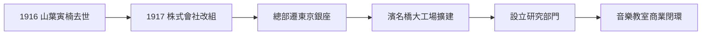

# 2.1 株式會社改組與濱名橋工場時代

1917年，日本樂器製造改組為「日本樂器製造株式會社」，總部遷至東京銀座，並在濱松的濱名橋附近擴建大規模工場，成為當時日本最大的樂器生產基地。此時山葉寅楠已於前一年（1916年）去世，公司進入「創辦人之後」的第二代經營，由職業經理人接棒，開始將創業期累積的技術與商譽制度化。

濱名橋工場不僅生產鋼琴與風琴，還開始製造吉他、曼陀林、管樂器等更完整的產品線，並在1920年代設立了專門的研究部門，對音響學、材料學與製造工程進行系統性研究。這些研究單位成為YAMAHA日後「以研發驅動多元化」的組織基礎。與此同時，公司也推動「音樂教室」業務，將樂器銷售與音樂教育綁定，形成獨特的商業閉環。

**因果分析**：創辦人去世是「因」，制度化轉型是「果」。許多家族企業在創辦人離開後迅速衰敗，但日本樂器製造透過株式會社改組，把個人技藝轉化為組織能力——研究部門是技術的制度化，音樂教室是市場的制度化。音樂教室的商業設計尤其關鍵：它讓「教音樂」成為「賣樂器」的驅動器，兩者互相強化，這一閉環至今仍是YAMAHA全球業務的核心結構之一。濱名橋工場的擴建則預示了濱松作為「音與引擎之城」的產業聚落地位。

## 下一節
* [2.2 第一次世界大戰後的擴張與挑戰](02.2-第一次世界大戰後的擴張與挑戰.md)
