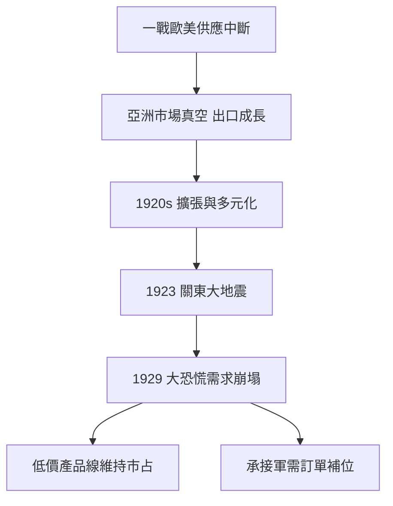

# 2.2 第一次世界大戰後的擴張與挑戰

第一次世界大戰期間，歐美樂器供應中斷，日本樂器製造意外獲得亞洲市場的真空期，出口大幅成長。戰後1920年代，公司持續擴張：設立分公司、擴充產品線、進軍電影與唱片相關事業，並在關東大地震（1923年）後參與東京的重建需求。然而1929年的世界經濟大恐慌與隨後的昭和金融恐慌，使國內樂器需求急凍，公司被迫裁員與緊縮。

面對需求崩塌，日本樂器製造採取了雙軌策略：一方面在既有樂器市場中推出更低價的產品線以維持市占；另一方面積極承接軍用與工業訂單，將木工與金屬加工技術轉用於木製飛機螺旋槳、木製零件與其他軍需品。這種「民用衰退時以軍需補位」的策略，使公司在1930年代得以維持工場運轉與技術人力，卻也把公司逐步捲入戰時體制。

**因果分析**：外部衝擊是「因」，策略轉向是「果」。大恐慌使民用需求消失，公司若不轉向軍需便可能倒閉；這是「生存邏輯」驅動的選擇，而非意識形態選擇。然而一旦承接軍需，公司的技術路徑就被鎖定在「木工＋引擎」的方向——螺旋槳製造培養了木材層壓與精密加工能力，這些能力在戰後反而成為摩托車與風扇葉片的技術源頭。歷史的弔詭之處在於：戰爭的黑暗需求，意外為戰後多元化儲備了技術種子。

## 下一節
* [2.3 戰時體制：從音叉到螺旋槳](02.3-戰時體制：從音叉到螺旋槳.md)
