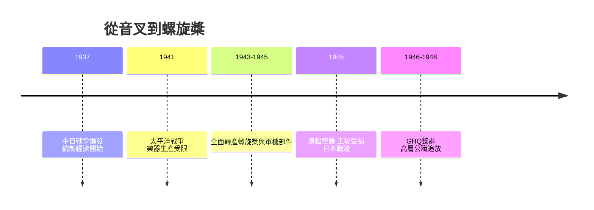

# 2.3 戰時體制：從音叉到螺旋槳

1937年中日戰爭爆發後，日本進入戰時統制經濟，1941年太平洋戰爭開打，民間樂器被視為「奢侈品」而遭到生產限制，金屬被優先供應軍工。日本樂器製造幾乎全面轉產軍需：以木工技術製造飛機螺旋槳、木製機翼部件、燃料箱，並參與「零式艦上戰鬥機」等軍用機的部分木製構件供應。公司在濱松、掛川等地的工場成為軍需生產據點，員工大量被徵調，戰爭末期更遭受空襲，濱松工場嚴重受損。

1945年日本戰敗，公司面臨的是雙重廢墟：物理上，工場與設備損毀；制度上，GHQ（盟軍最高司令部）對戰爭協力企業進行整肅與重整。日本樂器製造被認定為戰爭協力企業，高層遭到公職追放，公司被迫重新定義自己的存在意義。

**因果分析**：戰時統制是「因」，技術路徑轉換是「果」；戰敗是「因」，組織重建是「果」。這段歷史留下兩個深遠影響：第一，公司證明了木工與精密加工技術可以在完全不同的產業（樂器→軍機）中遷移，這一「技術可遷移性」的認知，直接啟發了戰後的多元化戰略；第二，戰爭罪責的歷史陰影，使戰後的經營層刻意以「音樂、文化、和平」作為企業敘事，試圖將品牌與音叉的「和諧」意涵重新連結，淡化軍需記憶。

## 下一節
* [3.1 廢墟上的復興與駐日美軍訂單](03.1-廢墟上的復興與駐日美軍訂單.md)
