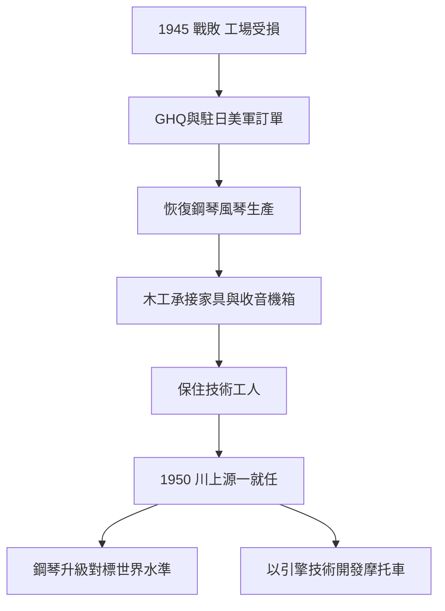

# 3.1 廢墟上的復興與駐日美軍訂單

1945年戰爭結束後，日本樂器製造面對幾乎歸零的國內需求。轉機來自一個意外客戶：GHQ與駐日美軍。占領軍為了娛樂與文化政策，需要修復學校的鋼琴與風琴，並訂購小型木製家具與樂器。公司迅速恢復鋼琴與風琴生產線，同時以木工技術承接軍用與占領當局的木製家具、收音機木箱等訂單，讓工場得以維持運轉、保住技術工人。

1940年代末，公司恢復了風琴與直立鋼琴的量產，並重新開始出口；1950年川上源一就任社長，他是山葉寅楠事業接班家族的後裔，推動了公司戰後最具決定性的兩項決策：一是全面恢復並升級鋼琴品質，以「世界水準」為目標；二是利用戰時累積的引擎與金屬加工技術，開發摩托車——這直接催生了1955年的山葉發動機分家。

**因果分析**：占領當局的訂單是「因」，技術人力保存是「果」；人力保存是「因」，高速復興是「果」。若沒有GHQ訂單在關鍵的1945-1948年間提供現金流，公司的工程師與技工可能流散至其他產業，1950年代便不可能同時支撐鋼琴升級與摩托車開發。川上源一的就任則是組織層面的關鍵節點：他以創業家族的合法性和經營者的魄力，把「戰時被迫多元化的技術」轉化為「戰後主動多元化的戰略」，這是本章至下章的因果樞紐。

## 下一節
* [3.2 山葉發動機1955年分家](03.2-山葉發動機1955年分家.md)
