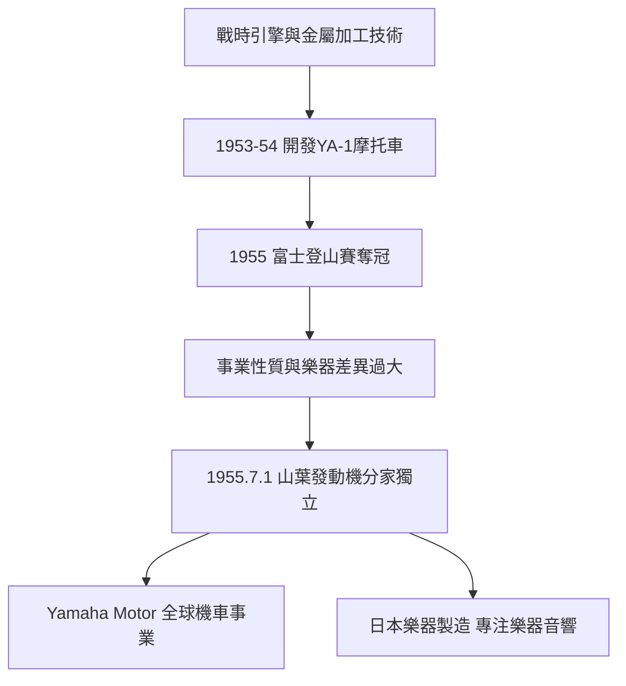

# 3.2 山葉發動機1955年分家

1955年7月1日，日本樂器製造將摩托車部門分立，成立「山葉發動機株式會社」（Yamaha Motor Co., Ltd.），由川上源一兼任首任社長。分家的背景是：1953年起公司以戰時引擎技術為基礎開發出YA-1摩托車（125cc，紅色車身），1954年試作、1955年量產，並在富士登山賽車等賽事中奪冠，展現驚人性能。然而摩托車事業與樂器事業在製造流程、通路與競爭節奏上截然不同——摩托車必須與本田、鈴木在價格與速度上硬碰硬，與「音的品牌」形象亦有衝突。

分家後，兩家公司各自演化：山葉發動機以YA-1的成功為起點，快速擴張機車產品線並進軍海外；日本樂器製造（1987年更名為YAMAHA株式會社）則專注於鋼琴、電子樂器與音響。兩家公司共享音叉商標的血統，卻成為彼此獨立的全球企業。

**因果分析**：分家是「果」，其「因」有三層：技術層面，戰時引擎技術提供了進入門檻；市場層面，1950年代日本機車市場爆發性成長吸引了公司投入；組織層面，樂器與機車的管理邏輯衝突迫使切割。這是一個「技術母體衍生新事業，再以分家釋放新事業成長動能」的經典案例。若不分家，機車事業可能被樂器文化的保守性拖慢，反之機車的激烈價格戰也可能拖垮樂器品牌的溢價能力。分家使兩者都獲得了專注的成長路徑，也使日後的「雙YAMAHA」格局成為可能。

## 下一節
* [3.3 木工與引擎技術的雙軌衍生](03.3-木工與引擎技術的雙軌衍生.md)
