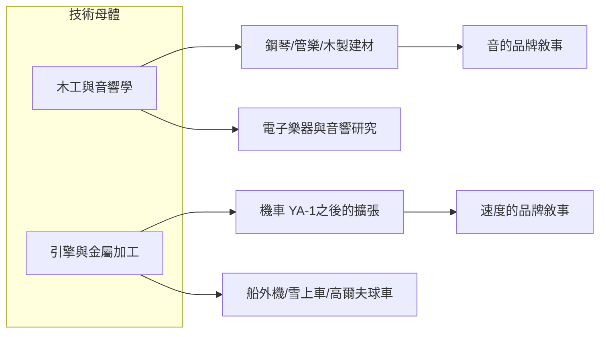

# 3.3 木工與引擎技術的雙軌衍生

分家之後，日本樂器製造與山葉發動機各自以「木工」與「引擎」為技術母體，展開雙軌衍生。樂器方面，公司以鋼琴音板所需的木材加工技術為核心，衍生出木製家具、建築材料、乃至於木材膠合與塗裝技術；機車方面，山葉發動機以二行程引擎技術為核心，衍生出船外機（1960年）、雪上車、高爾夫球車等產品。兩家公司雖已分立，卻在產品史中不斷出現「同一技術、不同載具」的鏡像關係。

更關鍵的衍生發生在1950年代末至1960年代：日本樂器製造開始將「音」的知識延伸到電子領域，研究電子風琴與音響設備；山葉發動機則以賽事成績為行銷武器，透過曼島TT等國際賽事建立「性能」的品牌敘事。兩家公司不約而同地發現：技術必須被敘事化（音的感動、速度的激情），才能轉化為品牌溢價。

**因果分析**：技術母體是「因」，產品衍生是「果」，品牌敘事則是讓「果」持續增值的再投資。這段歷史揭示了YAMAHA集團最獨特的戰略邏輯：它不是「多角化經營」的隨機擴張，而是「以可遷移技術為軸心的同心圓擴張」。木工衍生電子音響，是因為音響音箱本質上就是精密木工＋聲學；引擎衍生船外機，是因為船外機本質上就是小型引擎＋推進器。理解這一「技術遷移因果鏈」，是理解YAMAHA為何能橫跨看似毫無關聯的產業的鑰匙。

## 下一節
* [4.1 樂器出口全球與海外生產網](04.1-樂器出口全球與海外生產網.md)
