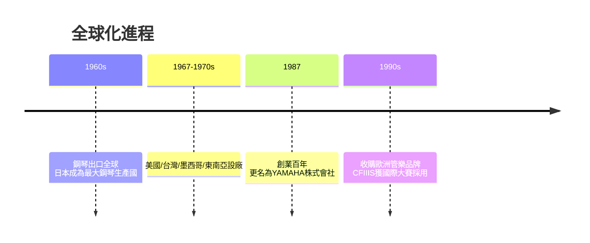

# 4.1 樂器出口全球與海外生產網

1960年代，日本樂器製造迎來全球化高峰。鋼琴出口量快速攀升，1965年前後日本已超越德國成為世界最大的鋼琴生產國，YAMAHA鋼琴進入美國、歐洲主流市場。公司不滿足於出口，更在海外設立生產據點：1960年代後半至1970年代，先後在美國、墨西哥、台灣、馬來西亞、印尼等地設立工廠，形成「日本研發、亞洲製造、全球銷售」的網絡。1987年，適逢創業一百週年，公司將名稱由「日本樂器製造」改為「YAMAHA株式會社」，象徵從「日本的公司」轉型為「世界的品牌」。

同時，公司持續以收購與合作強化高端品牌：1990年代收購了歐洲管樂器與配件品牌，並與史坦威等頂尖鋼琴品牌在高端市場展開品質競爭——後來YAMAHA的CFIIIS平台鋼琴成為多個國際鋼琴大賽的指定用琴，象徵品質已獲古典音樂界承認。

**因果分析**：內需成熟是「因」，出海是「果」。1950-60年代日本國內鋼琴普及率快速上升後趨於飽和，公司被迫向海外尋找第二成長曲線；而海外市場對「日本製」品質的疑慮，又驅動公司以「海外本地生產＋品質對標德國」的雙重策略化解。更名為YAMAHA則是品牌層面的因果閉環：海外消費者記不住「日本樂器製造」，卻記得住音叉標誌——公司的全球市場成就反過來驅動了組織的自我重新命名。

## 下一節
* [4.2 電子音樂與音響事業的崛起](04.2-電子音樂與音響事業的崛起.md)
