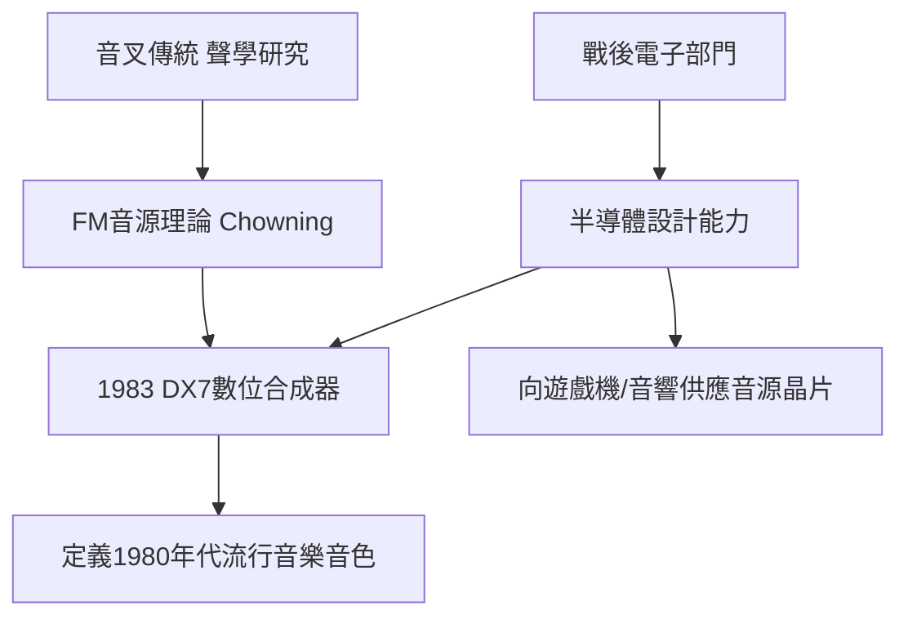

# 4.2 電子音樂與音響事業的崛起

1970年代起，YAMAHA大舉進入電子領域。1971年前後推出電子琴與合成器的早期產品；1976年推出管弦樂系列電子琴；1983年，與史坦福大學教授John Chowning授權合作的FM音源技術問世，推出革命性的數位合成器DX7。DX7全球銷售逾二十萬台，成為1980年代流行音樂的標誌性音源，麥可·傑克森、Whitney Houston等人的暢銷曲中都能聽到它的聲音。

DX7的成功不是偶然：它源自公司長期累積的聲學研究（音叉傳統）＋半導體設計能力（戰後電子部門的培育）＋與學術界的技术授權合作。同一時期，YAMAHA也進入音響設備（擴大機、混音器）與家用電子琴市場，並開始向其他廠商供應音源晶片——包括為世嘉、任天堂等遊戲機提供音效晶片，成為「半導體音源」的隱形冠軍。

**因果分析**：學術授權是「因」，產品革命是「果」。YAMAHA並未自行發明FM合成理論，而是以授權方式獲得史坦福的專利，再用自家的半導體工程能力將理論「產品化」——這體現了公司「不是發明者，而是最佳實現者」的組織性格。DX7的普及又反過來驅動了音源晶片的外銷事業：當全世界的音樂人都熟悉FM音色，遊戲機與音響廠商採用YAMAHA晶片的意願也隨之提高。「產品成功→音色普及→晶片生態擴大」形成了正反饋迴路。

## 下一節
* [4.3 與川崎、本田的競合與品牌KANDO](04.3-與川崎、本田的競合與品牌KANDO.md)
