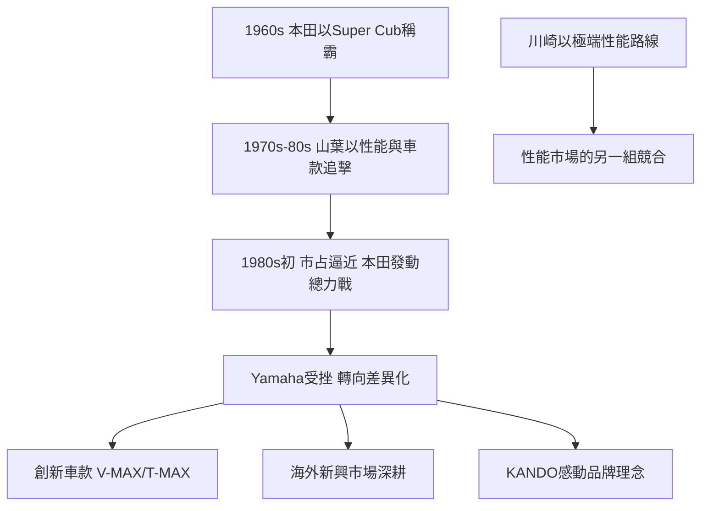

# 4.3 與川崎、本田的競合與品牌KANDO

在機車領域，山葉發動機與本田的競爭是日本產業史上最激烈的商戰之一。1960年代本田以Super Cub與賽事成就稱霸，山葉發動機以性能與設計迎戰，1980年代初在日本國內市場一度逼近本田的市占率。本田隨後發動價格與產品線的總力戰，Yamaha在1980年代初的競爭中受挫，此後轉向差異化：以創新車款（如V-MAX、T-MAX）與海外新興市場為重心。川崎重工則以重型機車的極端性能路線，與山葉形成「性能」市場上的另一組競合關係。

與此同時，YAMAHA集團確立了「KANDO」（感動）作為品牌理念——創造「感動與文化」的體驗。川上源一卸任後，YAMAHA持續以音樂教室、音樂廳、賽車運動（如參與MotoGP前身賽事）作為「感動」的載體，使品牌超越產品功能，成為一種生活方式的主張。

**因果分析**：競爭壓力是「因」，品牌理念是「果」。1980年代初與本田的正面對決失利，是Yamaha機車史上最重要的教訓：在規模與成本上無法壓倒本田，只能轉向「感動與獨特性」的差異化戰場。KANDO理念的確立，本質上是把「競爭失利」轉譯為「戰略升級」——不再追求市占率第一，而是追求「在顧客心中無可取代」。這一理念也使機車與樂器兩個事業在品牌層面重新統一：無論是引擎的咆哮還是琴弦的共鳴，都是「感動」的不同形式。

## 下一節
* [5.1 2008年收購Bösendorfer與鮑德溫](05.1-2008年收購Bösendorfer與鮑德溫.md)
