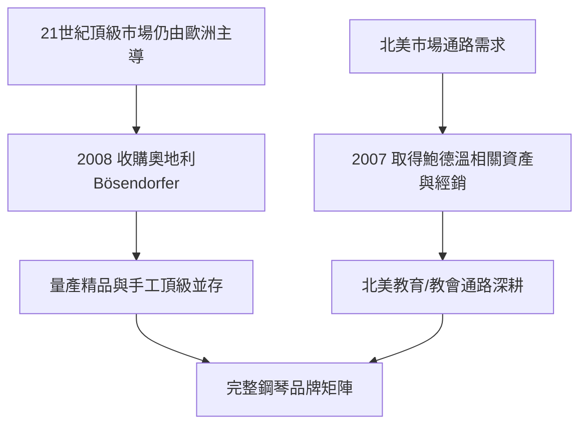

# 5.1 2008年收購Bösendorfer與鮑德溫

進入21世紀，YAMAHA在鋼琴市場的全球地位穩固，但在「頂級手工鋼琴」區隔仍由歐洲品牌主導。2008年，YAMAHA宣布收購奧地利百年鋼琴品牌Bösendorfer（貝森朵夫）——這是維也納傳統手工鋼琴的代表，曾為布拉姆斯等音樂家所鍾愛。此舉使YAMAHA首次同時擁有「量產精品」與「手工頂級」的完整產品光譜。

而在美國市場，YAMAHA早於2007年收購了百年鋼琴品牌鮑德溫（Baldwin）的經銷與部分資產——鮑德溫曾是美國最大鋼琴製造商，2001年破產後被吉布森（Gibson）收購，YAMAHA取得其部分經銷網與相關資產，強化在北美教育與教會市場的通路。這兩項布局共同構成YAMAHA在21世紀的鋼琴品牌矩陣：以YAMAHA為主力、以Bösendorfer攻頂級、以鮑德溫通路深耕北美。

**因果分析**：市場區隔是「因」，收購是「果」。YAMAHA的量產鋼琴在品質與性價比上已無對手，但「手工、稀有、傳承」的敘事無法靠量產複製——唯一的方式是收購一個擁有該敘事的品牌。Bösendorfer的收購，標誌著YAMAHA從「以製造能力競爭」升級為「以品牌組合競爭」；鮑德溫資產的取得則顯示公司對通路重於品牌本身的務實判斷。需澄清的是：YAMAHA並未收購Steinway（史坦威），那是其他買家的標的；YAMAHA的選擇是Bösendorfer，這一區別反映了公司「以奧地利手工品牌攻頂、以自有品牌守量」的清晰戰略。

## 下一節
* [5.2 半導體音源晶片與數位音樂帝國](05.2-半導體音源晶片與數位音樂帝國.md)
