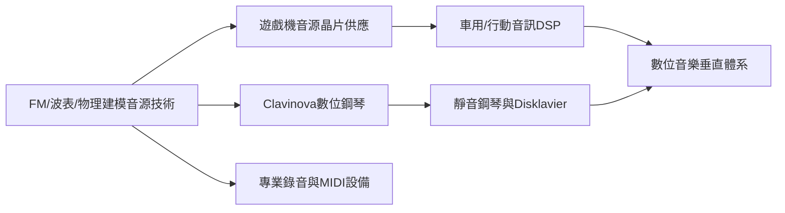

# 5.2 半導體音源晶片與數位音樂帝國

YAMAHA的半導體事業是集團最「隱形」卻影響最深遠的資產。從1980年代為遊戲機供應音源晶片（如世嘉與雅達利的街機音效晶片、多款任天堂平台的音源），到1990年代推出自主的波表合成（AWM）與物理建模音源，再到電子琴、數位鋼琴（Clavinova系列）、MIDI周邊與專業錄音設備，YAMAHA建立了橫跨「晶片→硬體→軟體→服務」的數位音樂垂直體系。

進入21世紀，公司將半導體事業轉移至子公司Yamaha LSI（後整合重組），專注於音訊DSP、觸覺回饋與車用音訊晶片，客戶涵蓋智慧型手機、汽車音響與工業設備。同時，YAMAHA以數位技術重塑傳統樂器：靜音鋼琴（可戴耳練習）、自動演奏鋼琴Disklavier（可遠端傳輸演奏資料，用於遠距教學與大師班）、以及以建模技術再現名琴音色的數位鋼琴，使「古典樂器」在數位時代獲得新生。

**因果分析**：晶片能力是「因」，產品多樣性是「果」。YAMAHA的數位音樂帝國並非來自某個明星產品，而是來自「同一音源核心，無限終端延伸」的平台邏輯：FM技術誕生於1983年，至今仍以改進形式存在於手機鈴聲、車用音響與合成器App中。更值得注意的是因果的反向流動：數位技術（因）讓傳統鋼琴「靜音化、連網化」（果），傳統鋼琴的聲學資料（因）又反過來訓練數位建模的精度（果）——類比與數位在YAMAHA內部形成互相餵養的循環，這是競爭者最難複製的結構性優勢。

## 下一節
* [5.3 今日的全球樂器與機車雙引擎](05.3-今日的全球樂器與機車雙引擎.md)
