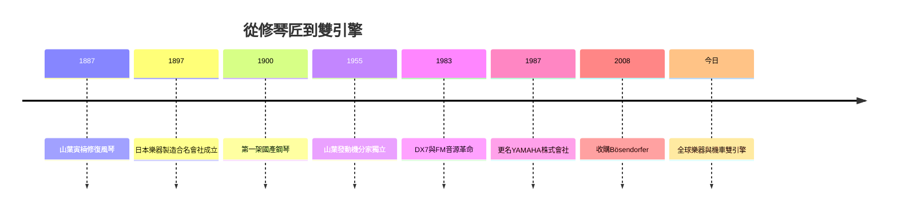

# 5.3 今日的全球樂器與機車雙引擎

今日的YAMAHA是一個「雙引擎」結構：YAMAHA株式會社（Yamaha Corporation）是全球最大的樂器與音響製造商，產品橫跨鋼琴、管弦樂器、電子樂器、專業音響、半導體與音樂教育；山葉發動機（Yamaha Motor）則是全球主要機車製造商之一，並延伸至船外機、水上摩托車、高爾夫球車、機器人與無人機等領域。兩家公司共享音叉血統與KANDO理念，卻各自獨立上市、獨立經營。

在機車事業，山葉發動機以MotoGP的長期參賽與多次年度冠軍維持「性能」敘事，並在東南亞、印度、非洲等新興市場與本田展開新一輪的規模競爭；在樂器事業，YAMAHA以「從第一堂音樂課到世界舞台」的完整光譜（音樂教室→學生琴→專業琴→Bösendorfer）覆蓋音樂人生的每個階段。2025年適逢山葉發動機創立七十週年，兩家公司也在電動化（電動機車、電子樂器）與數位化（遠距教學、串流演奏）上尋找共同的下一個成長曲線。

**因果分析**：回望整部企業史，其因果主軸是「技術遷移→事業衍生→組織分立→品牌統一」：修琴（因）催生樂器製造（果），樂器製造的木工與引擎技術（因）衍生機車（果），機車與樂器的管理衝突（因）導致1955年分家（果），分家後各自的成長（因）又使「音叉」品牌在兩個產業都獲得全球認知（果）。而貫穿一切的，是山葉寅楠在1887年那台壞風琴前展現的態度：面對不會的事，就去學會它。這一態度被制度化為研究部門、音樂教室與KANDO理念，成為YAMAHA跨越三個世紀仍在運轉的原始引擎。

## 回到目錄
* [README 目錄](README.md)
