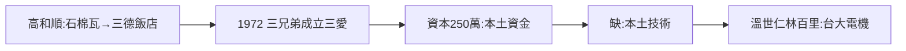

# 1.1 高和順從石棉瓦到三德飯店（1950–1970）

## 石棉瓦起家

高和順戰後從石棉瓦（asbestos 建材）生意起家，攢下第一桶金，再跨入旅館業，在台北承德路開設老牌三德飯店。從建材到旅館——典型的戰後台商路徑：**哪裡有缺口，就往哪裡鑽**。

## 三個兒子

高和順育有三子：高達雄、高琮富、高新平。1972 年，老父親出資，以三個兒子之名成立「三愛電子」——「三愛」即三兄弟之愛。資本額 250 萬元，在當時是一筆大錢（台北市中心一棟透天厝不過數十萬）。

## 飯店老闆辦電子廠的時代背景

- 1970 年代初，台灣電子業幾乎全是美日外資（加工出口區的 RCA、飛利浦）；
- 本土資金不懂技術，本土技術（台大電機）沒有資金；
- 三德飯店的錢 + 台大電機的人 = 三愛電子——**台灣第一次「本土資本 × 本土技術」的結合**。

**因果**：飯店的錢找到了電機的人，三愛的全部故事從此開始。下一節，1972 年創立的細節。
