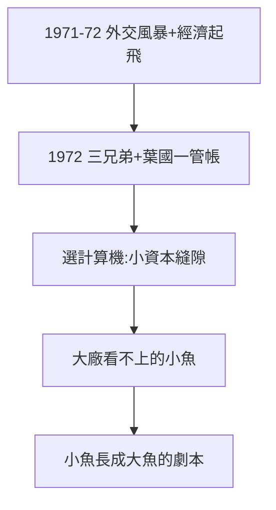

# 1.2 三兄弟與 1972 創立（1972）

## 1972：承德路的小工廠

三愛電子成立，工廠設在台北（承德路三德飯店一帶）。三兄弟分工：高達雄、高琮富、高新平共同經營，其中高琮富後來主導音響事業。懂會計的葉國一（士林高商畢業，做過廣告、肥皂、飼料生意）被找來當財務經理——日後英業達的創辦人，先在這裡管帳。

## 為什麼叫「電子」卻先做計算機

1970 年代初，台灣連電晶體收音機都多為外資廠生產，本土做「電子計算機」是跳級——但計算機單價高、批量小，最適合小資本起步。**小魚吃蝦米：選一個大廠看不上的縫隙**，是三愛的生存智慧，也是日後聯發科（CD-ROM）、廣達（筆電代工）的共同劇本。

## 1972 年的台灣

- 1971 年退出聯合國，1972 年尼克森訪華、台日斷交——外交風暴；
- 但經濟起飛：加工出口區全速運轉，蔣經國推十大建設前夜；
- 風雨中的創業：三愛的出生，恰逢台灣最不安、也最有幹勁的年代。

**因果**：錢（飯店）+ 人（葉國一管帳）+ 縫隙（計算機）= 1972 年開張。但開工廠最缺的不是錢，是 Engineer——下一節，一號與二號員工報到。
