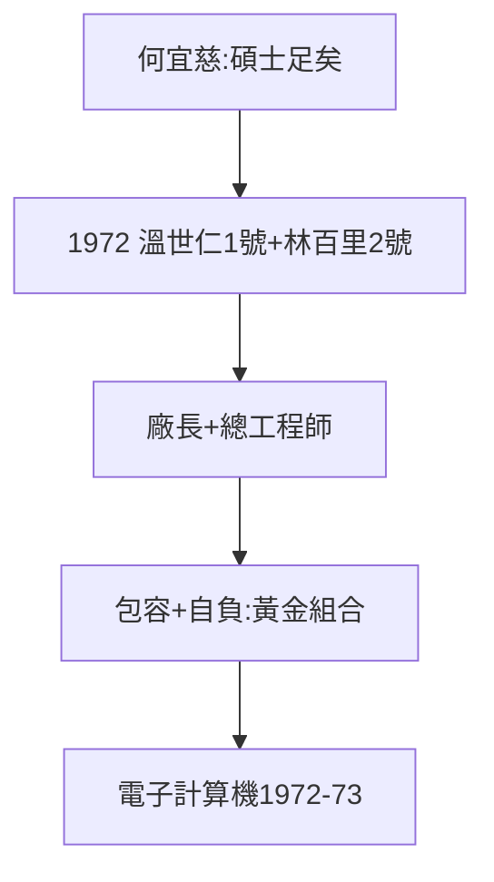

# 1.3 一號員工溫世仁二號員工林百里（1972）

## 台大電機的黃金組合

1972 年，兩個台大電機系畢業生走進三愛——因為家窮、出國無望（沒有錢留學），只好在台灣找工作：

- **一號員工溫世仁**：大林百里一歲，體格大兩號（日後 120 公斤），包容力強，24 歲當廠長；
- **二號員工林百里**：香港調景嶺貧民窟長大，難民之子，技術狂，實作第一名。

兩人在台大已合作做出台灣第一台迷你電腦（見 2.2）——三愛一次撿到兩個天才。

## 性格互補：勞萊與哈台

林百里自己說：做實驗沒人願跟他一組（太自負），只有溫世仁自告奮勇。日後出差：40 公斤的林坐半個位子，120 公斤的溫坐一個半——「勞萊與哈台」。**技術天才需要一個包容的管理者**，這是三愛給台灣科技史的第一課。

## 何宜慈老師的一句話

從 IBM 返台任教的何宜慈對林百里說：走實作路線，碩士足矣，不必讀博士。林百里放棄讀到第四年的博士，加入三愛——**台灣少了一個博士，多了一個產業**。

**因果**：沒錢出國（窮）+ 老師一句話 + 三愛的職缺 = 黃金組合。台灣電子業的起點，不是政策，是兩個窮學生的求職。下一章，計算機。
