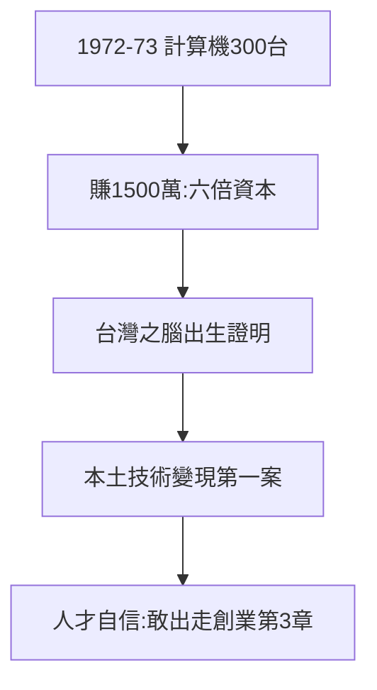

# 2.1 電子計算機三百台一千五百萬（1972–1973）

## 300 台，1500 萬

三愛創立不久，電子計算機賣出 300 台，賺了 1500 萬元——資本額才 250 萬，**一單回本還有找**。這是台灣電子產業的第一桶金，也是「本土技術變現」的第一個案例。

## 為什麼賣得掉

- 1970 年代初計算機是新鮮貨：銀行、貿易商、學校都要，進口貴（日本貨），三愛便宜；
- 溫世仁管廠、林百里管技術：品質不輸進口，維修隨叫隨到——**服務即競爭力**；
- 葉國一管帳：成本算得精，定價敢殺——生意人的本事（見 2.3）。

## 第一桶金的意義

1500 萬證明了一件事：**台灣人做得出、賣得掉電子產品**。此前外資廠（RCA）只把台灣當便宜的手，沒人相信台灣有腦。三愛的 300 台計算機，是台灣之腦的出生證明。

**因果**：黃金組合（1.3）+ 縫隙市場（1.2）= 第一桶金。而第一桶金的最大副產品不是錢，是自信——敢離開的人（第 3 章），都是在這裡賺到自信的。下一節，青年獎章。
