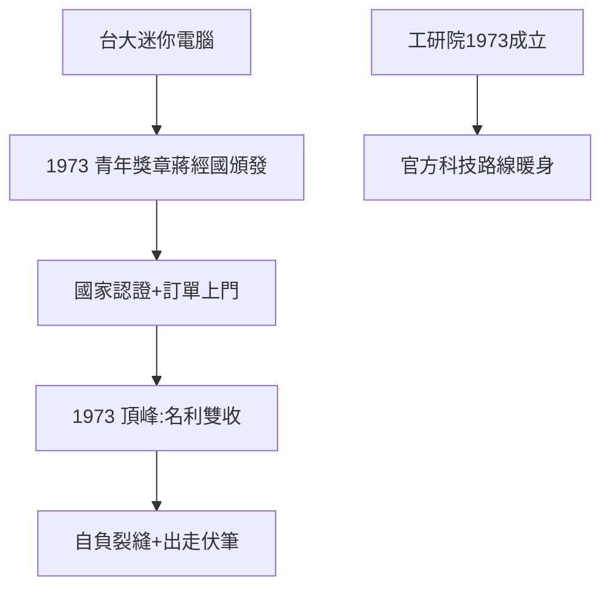

# 2.2 台灣第一台電腦與青年獎章（1973）

## 1973：行政院前集合

溫世仁、林百里在台大合作的迷你電腦（見 1.3），被教授推薦，兩人被叫到行政院前集合——行政院長蔣經國頒發第一屆「青年獎章」。24 歲的林百里半蹲著拍照，樂不可支，立刻寫信告訴顛沛一生的父親。這部電腦至今放在台大電機系館。

## 獎章的兩面

- 正面：國家認證——兩個窮學生成了樣板，媒體報導，訂單上門（三愛的計算機更好賣了，見 2.1）；
- 反面：林百里後來抱怨「幾乎都是我動手做的，溫世仁都在睡覺」——天才的自負，友誼的裂縫（多年後兩人分道，見 4.2）；
- 歷史：這是台灣第一次「官方為技術背書」——蔣經國的科技路線（工研院 1973 成立、RCA 計畫），從這枚獎章開始暖身。

## 電腦與計算機

注意：獎章電腦（台大習作，迷你電腦）≠ 三愛計算機（商品）。前者是名，後者是利——**名利雙收的 1973 年**，是三愛的頂峰。

**因果**：學校的習作（1.3）→ 國家獎章 → 公司訂單。1973 年名利雙收——而頂峰的另一面，就是下坡的起點（第 3 章：能幹的人都要走了）。下一節，葉國一。
