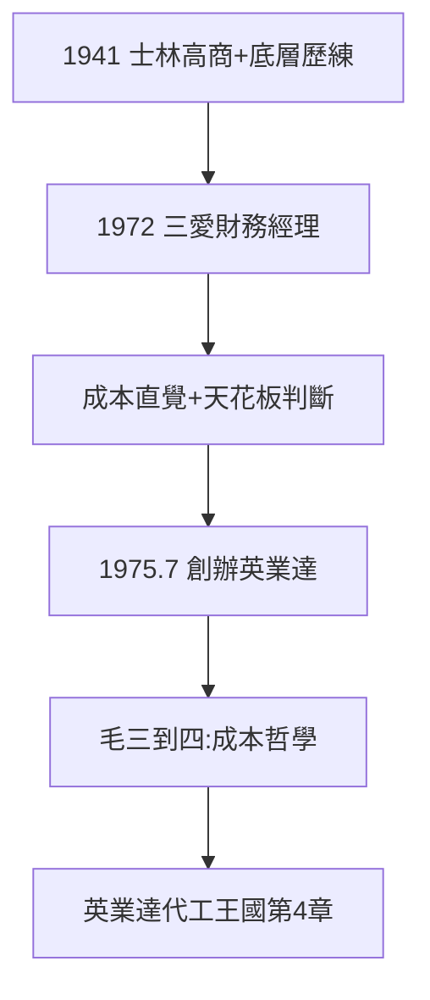

# 2.3 葉國一與副總經理之路（1972–1975）

## 1941 年台北：士林高商

葉國一 1941 年生，士林高商畢業。創業前做過廣告、肥皂、化工、飼料——「什麼都做過」的底層歷練，練出兩樣本事：**懂成本，敢下注**。1972 年被學長拉進三愛當財務經理，一路做到副總經理。

## 會計的眼睛

- 計算機 300 台 1500 萬（2.1）的定價，背後是他的成本帳；
- 他看懂三愛的天花板：家族企業（高家三兄弟）容不下外姓的野心——與其當副總，不如自己當老闆（見 3.2）；
- 1975 年 7 月，與鄭清和合夥創辦英業達，找來李詩欽當一號員工——**三愛的財務經理，變成英業達的老闆**。

## 「毛三到四」的預演

葉國一後來名言「代工是毛三到四」（三到四個百分點毛利），買地「躺著睡覺都賺」——這種成本直覺，正是在三愛管帳時練的。小公司的帳，養出大老闆的眼。

**因果**：管帳三年，看懂天花板——1975 年出走，是 1972 年入職時就寫好的結局。家族企業留不住外姓天才，這是三愛的結構性命運（第 3 章的主題）。下一章，分家。
