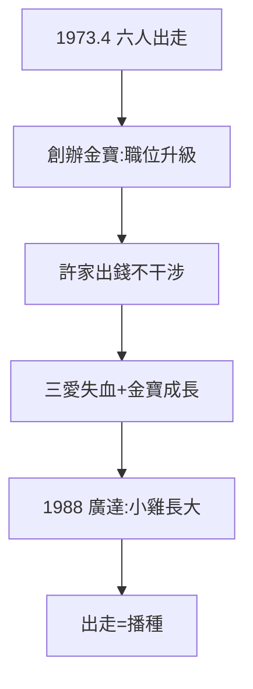

# 3.1 六人出走創金寶（1973–1974）

## 1973 年 4 月：六人離職

林百里、溫世仁、梁次震、姚四川、周永嘉、江英村六人離開三愛，創辦金寶電子（許潮英/許勝雄家族出資）。在三愛，溫任廠長、林任總工程師；在金寶，溫任總經理、林掌工程——**職位升級，舞台更大**。

## 為什麼出走

- 天花板：家族企業（高家）容不下外姓天才（2.3 的判斷，工程師也一樣）；
- 野心：計算機的成功（2.1）讓他們相信，沒有高家也行；
- 金寶的條件：許家出錢、不干涉——比高家更適合工程師的土壤。

## 三愛的第一滴血

六人出走，帶走技術骨幹。三愛元氣大傷——但歷史證明，**出走不是背叛，是播種**：金寶 15 年後孵出廣達（4.2），廣達的根，在三愛。母雞失血，小雞長大。

**因果**：第一桶金的自信（2.1）+ 家族天花板（2.3）= 出走。出走帶走三愛的血，留下台灣的種——下一節，第二批出走：葉國一。
