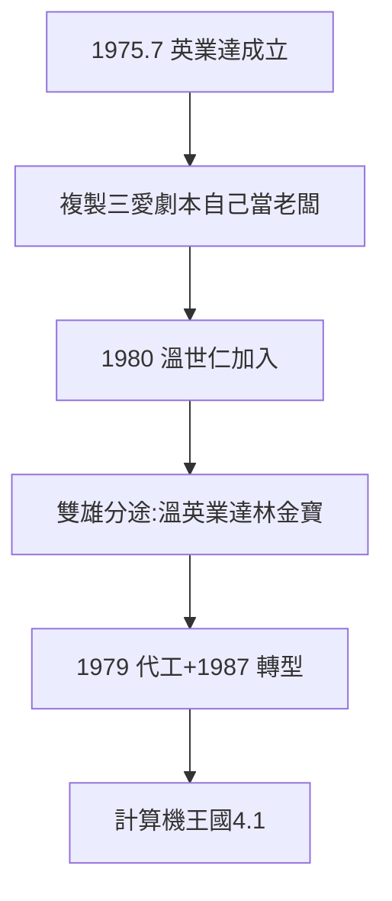

# 3.2 葉國一創英業達（1975–1980）

## 1975 年 7 月：英業達成立

葉國一與鄭清和合夥創辦英業達（Inventec），找來李詩欽（一號員工）。起步做計算機、電話機，自有品牌 INVENTA——**三愛的財務經理，複製三愛的劇本**（小資本、縫隙市場），只是這次自己當老闆。

## 1980：溫世仁加入

葉國一把老同事溫世仁找進英業達，從廠長做起。溫 36 歲當集團總經理、40 歲任副董事長——三愛一號員工，在英業達開花。而林百里留在金寶 15 年（1973–88）——**三愛雙雄分途，各自登山**（4.1、4.2）。

## 英業達的早期戰法

- 1979 切入計算機代工，1980 年代中期全台最大計算機製造商；
- 戰法：把平凡產品做到規模最大、成本最低（葉國一的成本哲學，2.3）；
- 1980 年代後期台幣升值：1987 年移往馬來西亞 + 轉進電腦——**成本鬥士的第一次轉型**（4.1 詳述）。

**因果**：管帳的天花板判斷（2.3）→ 1975 年出走 → 英業達。三愛的第二滴血，流出另一個巨人——下一節，高家自己的路：音響。
