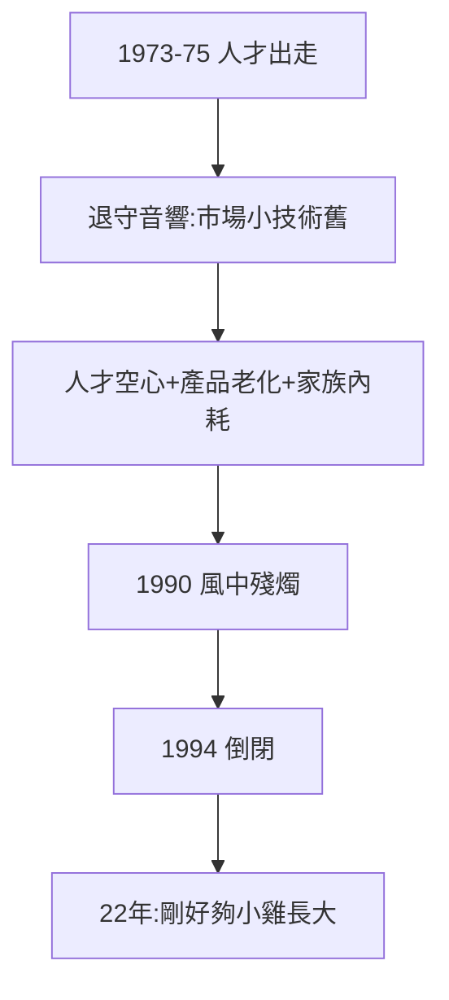

# 3.3 高琮富音響與三愛衰落（1975–1990）

## 高琮富專心音響

人才出走後（3.1、3.2），高琮富專心經營音響事業。三愛從「電子」退守「音響」——市場更小、技術更舊、競爭更激烈（日本山水、先鋒壓境）。**失去工程師的公司，只剩商人的公司**。

## 衰落的結構

- 人才空心：溫林葉走後，再無一流工程師加入（有本事的都去金寶、英業達）；
- 產品老化：計算機紅利吃完（2.1 的 300 台是絕唱），音響打不過日本；
- 家族內耗：三兄弟分工不明，決策緩慢——家族企業的通病，在順境時掩蓋，逆境時爆發。

## 1990：風中殘燭

1990 年代初，三愛名存實亡，靠變賣資產、高家貼補維持。1994 年倒閉（見 4.3）——從 1972 到 1994，22 年。**母雞的壽命，剛好夠小雞長大**。

**因果**：出走（3.1、3.2）→ 空心 → 衰落。三愛的死因不是外部競爭，是內部失血——而失血恰恰是台灣之福（小雞們都需要血）。下一章，小雞們的時代。
