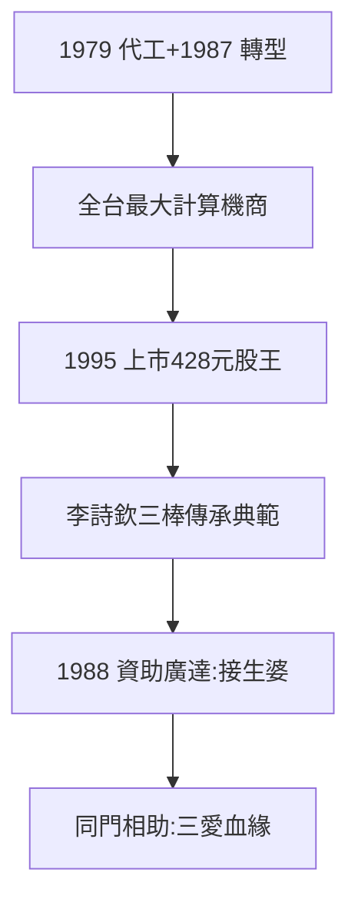

# 4.1 英業達計算機王國（1980–1995）

## 計算機代工之王

1979 年切入代工，1980 年代中期英業達已是全台最大計算機製造商。1987 年因台幣升值移往馬來西亞、轉進電腦——成本鬥士的轉型（3.2）。1995 年前後上市，股價漲到 428 元——**三愛財務經理的公司，變成股王**。

## 李詩欽與專業經理人

一號員工李詩欽 1998 年把英業達推上全球最大筆電生產商，2008 年葉國一交棒給他（專業經理人接班，全台首例「傳賢不傳子」），2017 年再交卓桐華，2023 年葉力誠（葉國一次子）接棒——三棒傳承，業界典範。

## 英業達的暗線：廣達的金主

1988 年林百里創廣達，葉國一、溫世仁各出資 4000 萬（約一半股本）、取名、銀行背書三年、調幹部幫忙（見 4.2）。**英業達是廣達的接生婆**——而接生婆與產婦，系出同門（三愛）。

**因果**：三愛的成本哲學（2.3）→ 英業達王國 → 資助廣達。而被資助的廣達，將超越資助者（2025 年廣達營收 2.12 兆 vs 英業達 6900 億）——下一節，廣達。
