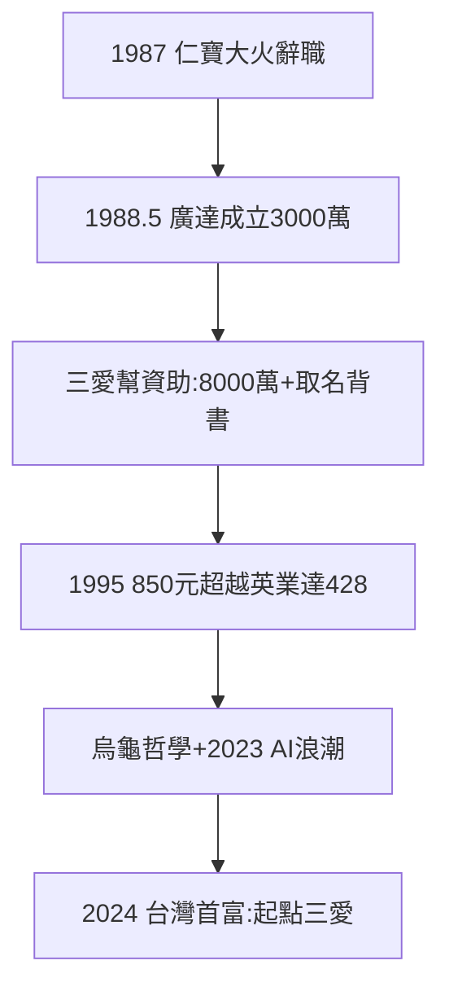

# 4.2 林百里創廣達（1988–1995）

## 1987：仁寶大火

林百里在金寶 15 年（1973–88，總經理兼仁寶總經理），1987 年仁寶平鎮廠大火，他引咎辭職。塞翁失馬：終於有時間做夢寐以求的筆記型電腦——**一把火，燒出廣達**。

## 1988 年 5 月：廣達成立

與梁次震（台大物理）在士林劍潭租兩層樓，資本 3000 萬，做筆電。葉國一、溫世仁各 4000 萬（4.1）、取名、背書、調幹部——三愛幫傾巢相助。1995 年前後，廣達股價 850 元，超越英業達的 428 元——**學生超越老師，小雞超越母雞，兄弟超越兄弟**。

## 烏龜哲學

林百里自創「烏龜哲學」：不跟兔子比，只跟自己比，一步一步。2023 年 AI 浪潮，廣達（雲達 QCT）市值近兆，林百里登頂台灣首富（2024，117 億美元）——**調景嶺貧民窟的孩子，53 年後台灣首富**。起點是三愛的一萬元薪水（西門町凱麗西餐廳那一餐，他說是一生最好吃的一餐）。

**因果**：三愛的技術（1.3）→ 金寶 15 年（3.1）→ 大火 → 廣達 → 首富。每一站都是三愛的延長線——而三愛本身，正在嚥氣（下一節）。
