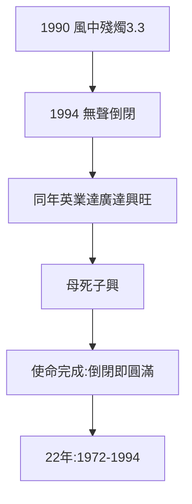

# 4.3 三愛 1994 倒閉（1994）

## 1994：無聲無息

三愛電子倒閉，沒有記者會，沒有追悼會。高琮富的音響事業收攤，高家退出電子業。22 年（1972–94），起於 250 萬，終於零——**台灣電子業的母親，死時無人送行**。

## 倒閉的對照

- 同年：英業達如日中天（上市前夜），廣達成立六年蒸蒸日上；
- 母死子興：三愛的訃告，恰是英業達、廣達的喜帖——同一年的兩面；
- 高琮富與葉林溫的落差：一個守成倒閉，一個出走封神——**守成 vs 出走，是台灣家族企業永恆的考題**。

## 倒閉的意義

三愛必須死：它的使命（證明本土技術可行、培養第一代人才）在 1980 年代已經完成。此後的每一天都是苟延——1994 年，只是拔管。**完成使命的公司，倒閉也是功德圓滿**。

**因果**：衰落的結構（3.3）→ 1994 拔管。而拔管之年，正是小雞們上市（英業達 428、廣達 850）的前夜——死亡與輝煌，同一枚硬幣。下一章，遺產。
