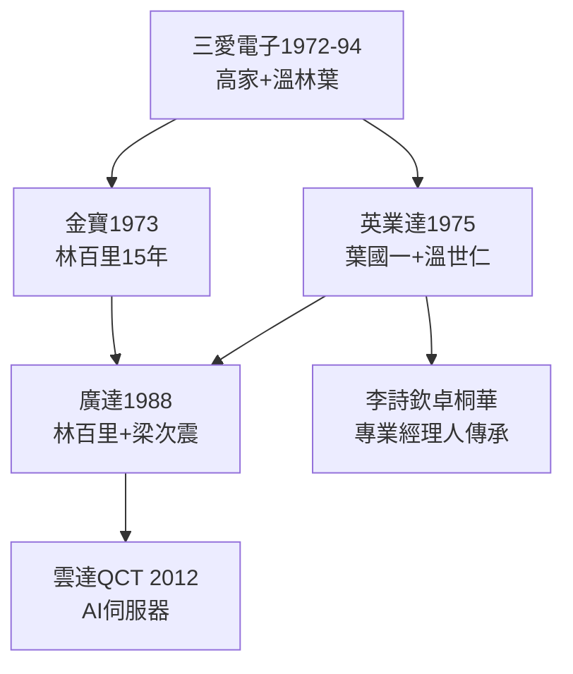
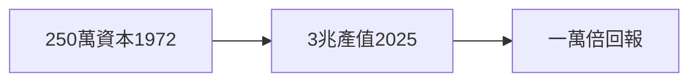

# 5.1 三愛幫譜系（1994–2026）

## 一張系譜圖

## 數字：母雞與小雞

| 公司 | 成立 | 2025 年營收 | 與三愛關係 |
|---|---|---|---|
| 三愛電子 | 1972 | 0（1994 倒閉） | 本尊 |
| 英業達 | 1975 | 約 6900 億 | 葉溫創辦 |
| 廣達 | 1988 | 約 2.12 兆 | 林創辦，葉溫資助 |
| 金寶 | 1973 | 併入仁寶系 | 林溫首站 |

**250 萬的資本，孵出 3 兆的產值**——一萬倍的回報，創投之神也做不到。

## 三愛幫的定義

在三愛共事過（1972–75）的一群人：溫世仁、林百里、梁次震、葉國一、李詩欽（英業達一號員工，廣義）……——台灣電子五哥（廣達、英業達、仁寶、緯創、和碩）中的兩哥，直系血親。

**因果**：分家（第 3 章）→ 開枝（第 4 章）→ 譜系（本節）。三愛的死亡（4.3）不是終點，是族譜的起點——下一節，族譜上最早凋零的一頁：溫世仁。
