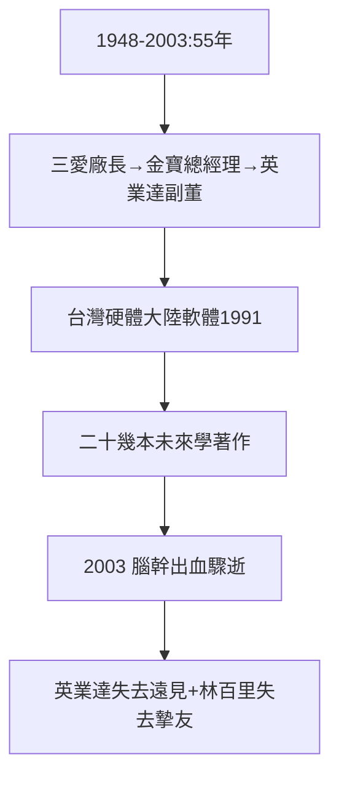

# 5.2 溫世仁早逝（2003）

## 2003 年底：腦幹出血驟逝

溫世仁 2003 年底因腦幹出血去世，享年 55 歲。時任英業達副董事長，正值壯年。科技圈震動——李詩欽說：「失去的不只是同事，是策略。」（英業達最晚赴大陸設廠，普遍認為與失去溫的遠見有關。）

## 思想型經理人

- 1991 年主張「台灣硬體、大陸軟體」，布局內陸軟體研發——超前二十年；
- 寫了二十幾本未來學的書，談烏托邦、談教育、談西部開發；
- 120 公斤的身體裡，裝著最輕盈的腦袋——「想遠方的人」，死於最近的血管。

## 勞萊走了，哈台獨行

林百里朋友不多，溫世仁是第一個（1.3 的實驗室組合）。2003 年後，林百里獨自帶著廣達衝向兆元——烏龜的另一半，是兔子馱著走的。每年清明，廣達老臣仍會提起溫廠長。

**因果**：一號員工（1.3）→ 三家公司（金寶、英業達）→ 2003 年驟逝。三愛幫譜系（5.1）的第一個缺口——而缺口處，透出光：英業達的傳承制度（李詩欽、卓桐華、葉力誠三棒）部分是為了不再失去第二個溫世仁。下一節，傳承。
