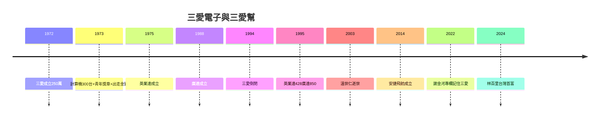

# 5.3 安捷飛航與傳承（2014–2026）

## 2014：安捷飛航成立

高健祐（高琮富之子，三愛第二代）在中國創業後回台，2014 年創立安捷飛航（Apex Flight Academy）：培訓機師、輕航機服務、醫療救援。資本額 3.8 億——**三愛的孫子輩，飛上天**（祖父做計算機，孫子開飛機）。

## 2022：謝金河的專欄

謝金河 2022 年專欄〈回顧三愛電子創業歷程〉，從安捷寫回三愛：三德飯店、高家三兄弟、一號溫世仁、二號林百里、300 台 1500 萬、英業達 428、廣達 850——**一篇專欄，半部台灣電子史**。三愛倒閉 28 年後，第一次被主流媒體完整記住。

## 傳承的閉環

- 高和順（石棉瓦）→ 高琮富（三愛音響，倒閉）→ 高健祐（安捷飛航，起飛）：祖父創業、父親守成失敗、孫子再創業——**家族的三代輪迴**；
- 溫林葉（出走封神）vs 高家（守成倒閉）：兩條路，兩種命運，同一個起點（1972）；
- 台灣電子業：從三愛的計算機（1972），到廣達的 AI 伺服器（2024）——**五十二年，從 250 萬到 3 兆**。

**因果閉環**：飯店的錢（1.1）→ 計算機的賺（2.1）→ 人才的走（第 3 章）→ 小雞的飛（第 4 章）→ 母雞的死（4.3）→ 孫子的飛（本節）。三愛證明了一個道理：**偉大的公司不一定長壽，長壽的不是公司，是它孵出的人**。承德路的小工廠拆了，三愛幫的族譜還在長——只要廣達的伺服器還在跑，英業達的傳承還在傳，安捷的飛機還在飛，三愛就沒有死。
