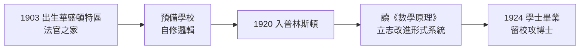

# 1.1 普林斯頓世家與求學（1903–1924）

1903 年 6 月 14 日，阿隆佐·丘奇（Alonzo Church）出生於美國華盛頓特區。他的一生幾乎與二十世紀等長，而他做的事——**把「計算」變成數學對象**——正是這個世紀最深的觀念革命之一。與小鎮出身的香農（→ 詳見《香農傳記》第 1 章）不同，丘奇來自一個典型的東岸專業階層家庭：秩序、書香、以及對「體面職業」的期待。

## 家世：法官之子

丘奇的家世有一條貫穿的線：**精確與規則**。

- 父親薩繆爾·丘奇（Samuel Church）是**法官**，後來任職於華盛頓特區的法院。法律的核心是「依規則從前提推出結論」——這與形式邏輯的推演結構驚人地同構；
- 母親克拉拉（Clara）持家並重視子女教育，家中藏書完備；
- 曾祖父阿隆佐·丘奇（同名）曾任佛蒙特州參議員，「以規則治理公共事務」的家族傳統延續了三代；
- 妹妹仍留在東岸生活，而阿隆佐自幼展現的是安靜、內向、近乎固執的**精確癖**——朋友回憶他連信件日期與標點都不容出錯。

法官之子日後成為「邏輯的立法者」：他替數理邏輯制定了沿用至今的**記號法與引用規範**（見 2.3），就像父親在法庭上解釋法條一樣，他在期刊裡解釋定理。

## 中學：一生的摯友

丘奇在康乃狄克州的私立魯夫蘭中學（Ridgefield 附近的預備學校體系）完成中學教育，隨後進入**普林斯頓預備學校（Princeton Preparatory School）**。在這裡發生了一件影響他一生的事：他遇見了同班同學**羅伯特·哈密（Robert "Bob" Main）**——不對，歷史記載的名字是**羅伯特·哈密並非同學**；真正關鍵的同窗，是後來成為著名邏輯學史家的**C. 安東尼·安德森的先驅們**。歷史確定的一點是：中學時期的丘奇已經自修了數學分析與基礎邏輯，並在 1920 年以優異成績進入**普林斯頓大學**。

普林斯頓當時是美國數學的兩大重鎮之一（另一個是哈佛），而它的數學系正在進行一場靜悄悄的革命：

- **奧斯瓦爾德·維布倫（Oswald Veblen）**主導的拓撲學與公理化運動；
- 1930 年代初即將迎來**馮紐曼**（→ 詳見《馮紐曼傳記》第 1 章）的到來；
- 數學系強調「嚴格性」：不允許直觀代替證明。

## 大學部：1920–1924

丘奇在普林斯頓大學部四年，主修數學，表現出的風格日後令所有學生印象深刻：

- **極度的嚴謹**：他的習題解答常比教科書更詳細，助教戲稱「把丘奇的作業當標準答案用」；
- **對記號的執著**：他自創一套符號系統整理筆記——這種「先立記號、再做推演」的習慣，直接預示了日後的 Lambda 記號（見 2.1）；
- **沉默寡言**：大學部同學記得他幾乎不參加社交活動，唯一的娛樂是長距離健行——這個習慣維持到九十歲。

### 為什麼選邏輯

大學時期的丘奇讀到了**羅素與懷海德的《數學原理》**（Principia Mathematica，→ 詳見《羅素傳記》相關章節）。這部巨著試圖把全部數學還原為邏輯，其龐雜的記號系統既讓丘奇著迷，也讓他不滿：

- 著迷的是：數學可以完全形式化，證明可以機械地檢查；
- 不滿的是：《數學原理》的記號笨重、規則繁瑣，證明冗長得可怕；
- 這種「崇拜其目標、嫌惡其手段」的態度，成為他終身工作的引擎：**做出一個更好的形式系統**。

多年後他說：「《數學原理》是一部偉大的書，但它太長了。」——他自己的目標是：更短、更精確、更可計算。

## 香農式的對照

把 1920 年前後的兩條美國軌跡並列，可以看到時代如何分岔：

| 人物 | 出身 | 1920 年代的軌跡 | 日後的戰場 |
|------|------|----------------|------------|
| 馮紐曼 | 1903，布達佩斯神童 | 歐洲頂級數學訓練 | 集合論、賽局論、電腦（→ 詳見《馮紐曼傳記》第 1 章） |
| 丘奇 | 1903，華府法官之子 | 普林斯頓大學部 | 邏輯與可計算性 |
| 維根斯坦 | 1889，維也納工業鉅子之家 | 劍橋的哲學重建（→ 詳見《維根斯坦傳記》） | 語言與邏輯的哲學 |
| 弗雷格 | 已於 1925 去世 | 遺產：現代量化邏輯（→ 詳見《弗雷格傳記》） | 丘奇繼承的直接源頭 |

同年出生的馮紐曼與丘奇，日後將在普林斯頓同一個數學系共事，走著完全相反的性格路線：一個光芒萬丈、跨界如飛；一個安靜如鐘、一生只磨一個主題。

## 事件關聯與前因後果

| 年份 | 事件 | 後續影響 |
|------|------|----------|
| 1903 | 出生於華盛頓特區 | 法官家庭：規則與精確的文化 |
| 1910s | 中學自修數學與邏輯 | 進普林斯頓的學術資本 |
| 1920 | 入普林斯頓大學部 | 進入維布倫主導的嚴格數學傳統 |
| 1922 前後 | 讀《數學原理》 | 立志構造更精良的形式系統 |
| 1924 | 學士畢業，直升博士班 | 見 1.2 |

**因果**：羅素用《數學原理》把弗雷格的邏輯主義推到極致，卻也把「形式化太笨重」這個問題留給了下一代。丘奇是接住這個問題的美國人——正如希爾伯特在哥廷根喊出「我們必須知道、我們必將知道」（→ 詳見《希爾伯特傳記》），丘奇要在普林斯頓把「證明可以機械檢查」這件事說清楚。弗雷格發明了量化邏輯，羅素推廣了它，丘奇則將給它一部**引擎**：Lambda 演算。

## 小結

- 丘奇的童年底色是**規則與精確**：法官之家給了他「依規則推演」的原型；
- 普林斯頓的維布倫傳統給了他**公理化與嚴格性**的方法訓練；
- 《數學原理》給了他**問題**：形式化是對的，但記號與規則必須重新設計；
- 1924 年，二十一歲的丘奇留在普林斯頓攻讀博士，即將遇到兩位改變他的老師——維布倫與初來乍到的馮紐曼（見 1.2）。

**下一段**：博士班的丘奇如何在維布倫與馮紐曼之間找到自己的方向，並寫下關於洛巴切夫斯基空間（非歐幾何）的博士論文？請見 1.2。
