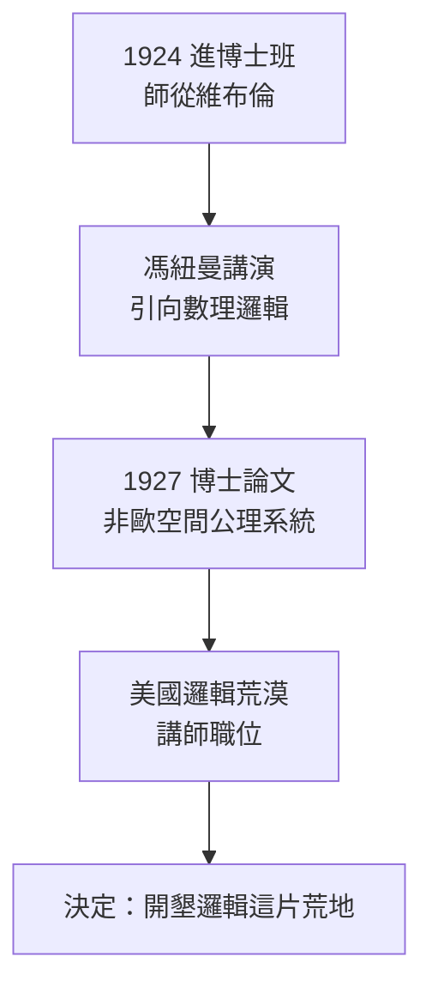

# 1.2 師從維布倫與馮紐曼、博士論文（1924–1927）

1924 年，二十一歲的丘奇進入普林斯頓數學系研究所。此時的普林斯頓正處於黃金時代的開端：維布倫掌舵，年輕一代的 Solomon Lefschetz 鋒芒畢露，而一場更大的地震正在醞釀——**約翰·馮紐曼**即將渡海而來。丘奇選擇的指導教授是**奧斯瓦爾德·維布倫**，這個選擇決定了他一生的品味：公理化、嚴格、記號至上。

## 維布倫：公理化的舵手

維布倫對丘奇的影響可以歸納為三條：

- **公理化方法**：維布倫早年寫過《實數的有限性公理系統》，主張每個數學分支都應建立在最少的公理之上——丘奇把這種態度帶進邏輯，日後他要求每個形式系統的每一條規則都必須明文列出；
- **結構主義的眼光**：維布倫研究拓撲，關心的是「在變換下不變的關係」——丘奇在邏輯中的對應物是「在記號系統下不變的可計算性概念」；
- **編輯的訓練**：維布倫長期參與期刊與叢書的編務，這直接影響丘奇日後主編《符號邏輯期刊》四十年（見 3.1）。

## 馮紐曼的到來

1929 年前後，比丘奇僅年長半歲、卻已在集合論上震撼世界的馮紐曼造訪並不久後落腳普林斯頓（→ 詳見《馮紐曼傳記》第 1 章）。丘奇聆聽了馮紐曼關於**集合論證明論**的講演，深受觸動：

- 馮紐曼講的是希爾伯特綱領（→ 詳見《希爾伯特傳記》）的核心：替數學的每一支尋找**相容性證明**；
- 丘奇後來回憶，正是這些講演把他引向**數理邏輯**——原本他可能成為一位幾何學家；
- 有趣的反差：馮紐曼一生快進快出各領域，丘奇則在馮紐曼只停留一學期的主題上**停留了七十年**。

## 博士論文：非歐幾何的公理系統

1927 年，二十四歲的丘奇完成博士論文《**洛巴切夫斯基空間的交替集**（Alternatives to Zermelo's Assumption）》——更精確地說，其主題是關於**羅巴切夫斯基（非歐）空間的公理體系與二階算術的替代方案**。這篇論文表面上是幾何基礎，骨子裡是**公理系統的方法論**：

- 他逐條分析公理之間的獨立性與相容性；
- 論文以維布倫式的一絲不苟寫成：每個符號首次出現必先定義，每步推演必註明依據；
- 導師維布倫的評語只有一個關鍵詞：**exacting（嚴苛得無懈可擊）**。

值得強調的是因果鏈：這篇論文雖屬幾何基礎，但它訓練出的能力——**把一個系統的全部假設攤在桌上逐一檢驗**——正是十年後他在 1936 年論文中「定義可計算性」所需的全部功夫（見 2.1）。可計算性問題本質上就是一個公理化問題：**如何用最少的原始概念，把「能算」這件事變成數學定義**。

### 博士後的迷惘期

取得博士學位後，丘奇經歷了一段少為人知的低潮：

- 1927–1928 年，他先後在普林斯頓擔任講師、赴哈佛與哥廷根訪問（見 1.3）；
- 美國的邏輯研究當時近乎荒漠：全國懂數理邏輯的學者屈指可數；
- 丘奇一度懷疑以邏輯謀生的可行性——那時邏輯在數學系眼中「只是哲學的殘餘」；
- 但他做了關鍵決定：**不轉行，自己開墾這片荒地**。

## 事件關聯與前因後果

| 年份 | 事件 | 後續影響 |
|------|------|----------|
| 1924 | 進入普林斯頓博士班 | 接受維布倫公理化訓練 |
| 1925 前後 | 聽馮紐曼講集合論證明論 | 轉向數理邏輯 |
| 1927 | 完成博士論文 | 「假設清單」方法論成型 |
| 1927–28 | 哈佛、哥廷根短期訪問 | 得見希爾伯特學派的風格 |
| 1929 | 返普林斯頓任教（見 1.3） | 美國邏輯學派的起點 |

**因果**：希爾伯特綱領經由馮紐曼的講演傳到丘奇耳中；維布倫的公理化訓練給了他工具；而哥廷根的訪問讓他確認——這場「數學基礎之戰」的戰場將從德國轉移，因為 1930 年代初的德國即將被政治吞噬。丘奇選擇在新澤西的小鎮上建立一個「哥廷根的分部」。

### 與羅素的對照

羅素在《數學原理》中花三百多頁才證明 $1+1=2$（→ 詳見《羅素傳記》），因為他的系統缺乏**函數的統一記法**。丘奇終身記得這個痛點：Lambda 演算的核心動機之一，就是替《數學原理》中繁瑣的函數記號（$\hat{x}$ 之類）找到一個經濟而萬能的替代品——$\lambda x.\,M$。一個記號的改進，最後長成了可計算性理論的基礎。

## 小結

- 維布倫給了丘奇**公理化方法**與期刊編務的範式；
- 馮紐曼的講演是**決定性的觸媒**，把幾何學徒變成邏輯學家；
- 博士論文訓練出「假設清單」方法——十年後「定義可計算性」正是這種方法的最高應用；
- 1927 年的美國邏輯幾乎是空地，丘奇決定親手開墾；
- 下一步是跨越大西洋：到歐洲親眼看看希爾伯特學派與阿姆斯特丹的邏輯中心（見 1.3）。

**下一段**：訪學歐洲、與布勞威爾學派的碰撞、以及返回普林斯頓開始長達四十年的教學生涯——請見 1.3。
