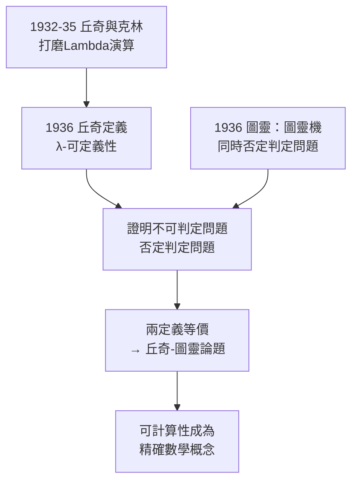

# 2.1 1936 年《不可解的初等算術問題》與 Lambda 演算、丘奇-圖靈論題（1936）

1936 年是數學基礎史上奇蹟般的一年：丘奇在《美國數學期刊》與《符號邏輯期刊》上連發數篇論文，其中**《一個不可解的初等數論問題》（An Unsolvable Problem of Elementary Number Theory）**與**《數學與邏輯中的原始遞迴函數類》**等，完成了兩件大事：**定義了「有效可計算性」**，並**證明了存在不可判定的問題**。同年稍晚，一位二十二歲的英國人在英國獨立得出同樣結論——他的名字叫圖靈。

## Lambda 演算：先有引擎，再有定理

丘奇的不可解性證明並非空中樓閣，它建立在他與克林在 1932–1935 年間逐步打磨的**Lambda 演算**之上：

- 核心記法：$\lambda x.\,M$ 表示「以 $x$ 為自變數的函數 $M$」；$(\lambda x.\,M)\,N$ 表示代入，即 $\beta$-歸約；
- 整個系統只有極少數規則（$\alpha$、$\beta$、$\eta$），卻足以表達一切計算：自然數（丘奇數）、遞迴、條件分支全部由純粹的函數構造出來；
- 動機回到《數學原理》：用一套**統一、經濟**的記號取代羅素笨重的函數符號（見 1.1、1.2）；
- 1934 年克林發現丘奇最初的系統不一致，師生合力以「類型化與限縮」救回核心——這段合作的細節見 3.3。

Lambda 演算的哲學宣告是：**「函數」是最原始的數學對象，一切由代入生成。** 這個立場五十年後將席捲程式語言世界（見 5.1）。

## 不可解性定理

有了 Lambda 演算，「有效可計算」第一次有了精確定義。丘奇隨即用它鑄成重錘：

1. 將「問題」編碼為自然數上的函數（後稱**丘奇編碼**）；
2. 證明有一個自然數謂詞 $P$，其特徵函數不是任何 $\lambda$-可定義函數；
3. 於是判定「給定 $n$，$P(n)$ 是否成立」的問題**不可解**——沒有任何有效程序能判定它。

這是**歷史上第一個被嚴格證明的不可判定問題**。它直接重創了希爾伯特綱領的核心——**判定問題（Entscheidungsproblem）**：是否存在機械程序判定任意一階邏輯語句的真假？丘奇的答案是：不存在。希爾伯特「我們必須知道」的口號，第一次撞上了「證明了不能知道」的牆（→ 詳見《希爾伯特傳記》）。

## 圖靈的平行宇宙

1936 年 5 月，遠在劍橋的**艾倫·圖靈**提交了《論可計算數》（→ 詳見《圖靈傳記》第 2 章），用完全不同的工具——**圖靈機**——證明了同一個否定結論。兩人素未謀面、工具迥異：

- 丘奇：代數式、函數式、符號歸約——**Lambda 演算**；
- 圖靈：機器式、狀態式、紙帶掃描——**圖靈機**；
- 結論卻相同：$\lambda$-可定義函數 ＝ 圖靈可計算函數 ＝ 直觀上的「可有效計算」。

丘奇以審稿人與導師的身分迅速確認了圖靈的工作，並邀他來普林斯頓做博士（1936–1938，詳見 3.3）。兩條路殊途同歸，這個「定義的穩健性」本身就是最強的哲學證據。

### 丘奇-圖靈論題

1936 年之後，學界把這個等式正式命名為**丘奇-圖靈論題（Church-Turing Thesis）**：

> **凡直觀上可有效計算的函數，都是圖靈可計算的（等價地：都是 $\lambda$-可定義的）。**

它至今無法證明（「直觀上可有效計算」不是數學概念），卻被視為計算科學的第一原理。所有後續工程——從香農的開關電路（→ 詳見《香農傳記》02.1）到馮紐曼架構（→ 詳見《馮紐曼傳記》）到雲端計算——都默默以它為擔保。

## 事件關聯與前因後果

| 年份 | 事件 | 後續影響 |
|------|------|----------|
| 1932–35 | 丘奇-克林發展 λ 系統 | 「可計算」獲得第一個精確定義 |
| 1936 春 | 〈不可解的初等數論問題〉 | 首個不可判定性定理 |
| 1936 | 〈論判定問題〉短文 | 正式否定希爾伯特的 Entscheidungsproblem |
| 1936.5 | 圖靈提交〈論可計算數〉 | 獨立平行證明 |
| 1936 秋 | 圖靈抵普林斯頓 | 兩大定義在同一屋簷下會師（見 3.3） |

**因果**：哥德爾 1931 年的不完備定理（→ 詳見《馮紐曼傳記》《希爾伯特傳記》）已經動搖了希爾伯特綱領，但哥德爾用的「原始遞迴」還不足以捕捉全部計算。丘奇（以及圖靈）補上了關鍵一步：**更廣的可計算函數類**，使「不可判定」不僅是真，而且**可證明地機械不可解**。哥德爾起初對丘奇的定義心存疑慮，直到圖靈機出現才完全信服——他後來明言：圖靈的定義是正確的。而圖靈本人則說：若非丘奇先提出論題的 $\lambda$ 版本，他的論文未必如此成形。

## 小結

- Lambda 演算是丘奇從 1932 年起手工鍛造的「計算引擎」，動機源自對《數學原理》記號的不滿；
- 1936 年他用這部引擎證出**史上第一個不可判定問題**，擊沉了希爾伯特的判定問題；
- 同年圖靈以圖靈機獨立達成同一結論，兩個定義的等價催生了**丘奇-圖靈論題**；
- 可計算性從心理直覺變成數學對象——這是計算機科學的奠基時刻；
- 但丘奇 1936 年的工作有一個缺口：他的系統在**邏輯**上仍不夠安全，第二年他就會用「型別」補上（見 2.2）。

**下一段**：1940 年的《邏輯系統的構造》如何以簡單型別理論同時救回邏輯一致性與表達力——請見 2.2。
