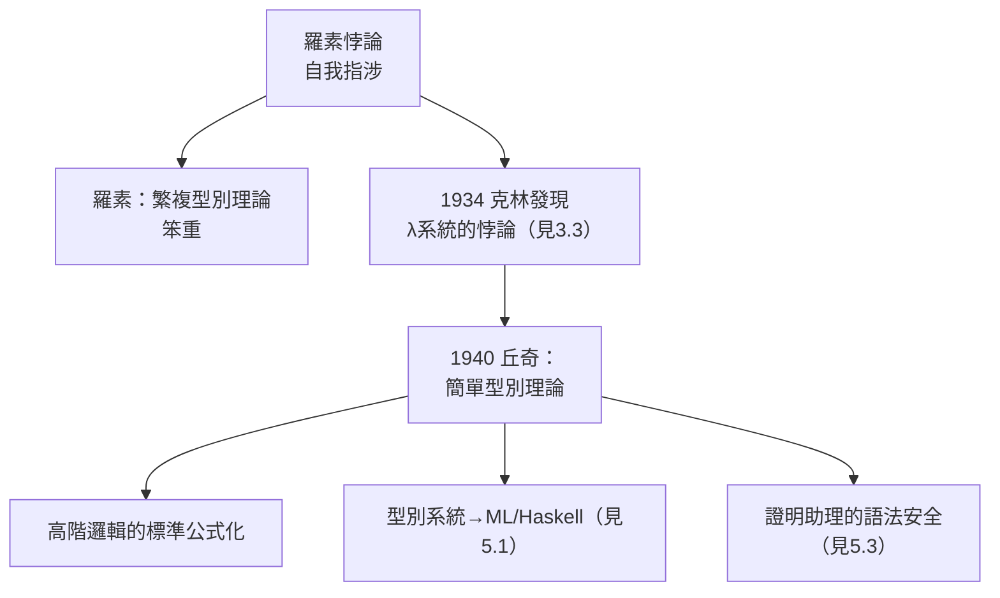

# 2.2 《邏輯系統的構造》與型別理論（1940）

1940 年，丘奇在《符號邏輯期刊》創刊號上發表了他僅次於 1936 年工作的第二篇經典：**《一個簡單型別理論的公式化》（A Formulation of the Simple Theory of Types）**。這篇十餘頁的論文把羅素階層化的繁複型別系統壓縮成一個優雅的體系，並與其 1940 年的宏觀作品《邏輯系統的構造》計畫一起，定下了此後八十年邏輯與型別論的基本格局。

## 背景：為什麼需要型別

Lambda 演算威力強大，卻有一個致命傷：**允許自我應用**。表達式 $M\,M$（把 $M$ 應用到自己身上）在無型別系統中完全合法——而克林 1934 年發現的悖論正是從這裡闖進來的（見 3.3）。這是羅素悖論（「所有不包含自身的集合之集合」）的函數版重演（→ 詳見《羅素傳記》）：

- 羅素的解法是**階型理論（ramified theory of types）**：層層設防，繁複到《數學原理》幾乎不可讀；
- 羅素自己還得加上可化歸公理來救可用性，等於自拆城牆；
- 丘奇的解法則是**簡單型別（simple types）**：把型別分為基本型 $\iota$（個體）、$o$（命題）與函數型 $\sigma \to \tau$，並規定**每個應用 $M\,N$ 都要求 $N$ 的型別恰為 $M$ 的定義域**。

一條規則，杜絕一切自我應用：$M\,M$ 型別不合，直接在語法層面被禁止。悖論不是被「反駁」的，而是被**型別檢查**擋在門外的。

## 《一個簡單型別理論的公式化》的內容

這篇 1940 年論文的結構極為經濟：

1. **型別的歸納定義**：從 $o$ 與 $\iota$ 出發，用 $\to$ 反覆生成；
2. **語言**：帶型別標註的 $\lambda$ 記法，加上等詞、量詞與否定等常元——它們全都可用 $\lambda$ 項加上邏輯常元定義；
3. **公理與規則**：寥寥數條，包括函數外延性（$\eta$-規則）與描述符的處理；
4. **成果**：系統被證明（相對地）**一致**，且足以承載**高階邏輯**——一階、二階……乃至任意階的量詞全部一體處理。

這套系統今日被稱為**丘奇的簡單型別理論（Church's Simple Theory of Types, STT）**，它有三重身分：一種邏輯（高階邏輯的標準公式化）、一種型別系統（Hindley–Milner 型別推斷與 ML 語言的遠祖，見 5.1）、一種語義基礎（蒙太格語法的骨架）。

## 與哥德爾、塔斯基的交錯

1940 年前後，基礎研究的三條線在丘奇手中會合：

- **哥德爾** 1940 年出版《連續統假設的相容性》，用可構造全集——兩人都把「階層」當作武器（→ 詳見《馮紐曼傳記》）；
- **塔斯基**的真值定義為高階系統的語義提供了標準框架，丘奇在普林斯頓的研討班上反覆討論；
- 丘奇則提供了第三條線：**把階層寫進語法**，讓不一致性在書寫時就不可能發生。

這種「語法擋住悖論」的思想，八十年後成為每一個證明助理的核心安全機制（見 5.3）。

## 事件關聯與前因後果

| 年份 | 事件 | 後續影響 |
|------|------|----------|
| 1934 | 克林發現無型別 λ 系統悖論 | 型別化成為必然（見 3.3） |
| 1936 | 丘奇提出 λ 定義與不可解性 | 可計算性確立，但邏輯系統仍需修補 |
| 1940 | 〈簡單型別理論的公式化〉 | 高階邏輯、型別論、語義學的三合一基礎 |
| 1940 | 哥德爾《連續統假設》出版 | 階層方法兩線並進 |
| 1958 前後 | Curry–Howard 對應萌芽 | 證明即程式（見 5.3） |

**因果**：沒有 1934 年的悖論，就沒有 1940 年的型別；沒有 1940 年的型別，就沒有日後 ML 的型別推斷、Haskell 的純函數型別系統、以及 Coq/Lean 中「證明即程式」的整座大廈。丘奇在此展示了他方法的典型樣貌——**遇到矛盾，不修修補補，而是重新設計語言**。

### 與卡爾納普的呼應

同一時期，邏輯實證主義者卡爾納普（→ 詳見《卡爾納普傳記》）正在發展「邏輯語法」：哲學問題可化為語言選擇問題。丘奇的型別理論給了卡爾納普式的直覺一個數學示範——**換一種語言（加型別），一類「問題」（悖論）就整批消失**。兩人日後在普林斯頓的可算度性討論（→ 詳見《卡爾納普傳記》03.2）正建立在這種「語言優先」的共同信念上。

## 小結

- 1940 年的簡單型別理論用**一條型別規則**化解了自我應用悖論，取代了羅素的繁複階型；
- 它是高階邏輯的標準公式化，也是日後**所有靜態型別函數式語言**的直系祖先；
- 與哥德爾的階層建構、塔斯基的語義學同時代互補，構成戰前基礎研究的收官之作；
- 丘奇的原則「用更好的語言消滅問題」將貫穿其教科書（見 2.3）與遺產（見 5.3）；
- 有了理論，接著需要**制度與教材**——1944 年起，《符號邏輯學導論》將把丘奇的方法傳播給整個世代（見 2.3）。

**下一段**：教科書、學派、以及丘奇如何以四十年主編生涯建立邏輯的「司法制度」——請見 2.3。
