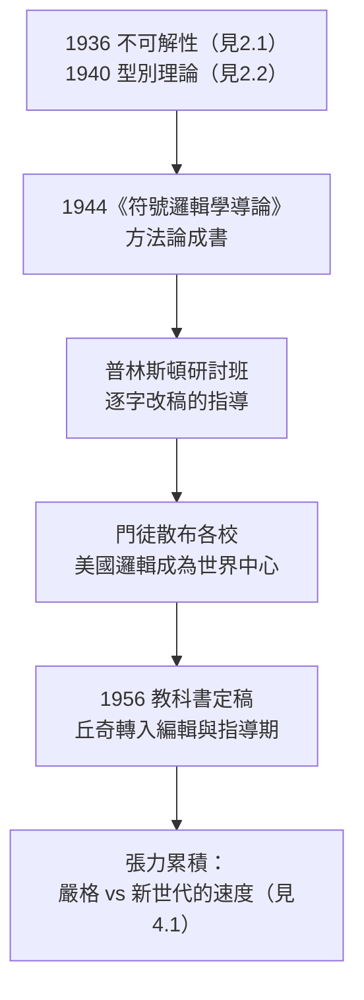

# 2.3 《符號邏輯學導論》教科書與丘奇學派（1944–1956）

1944 年，丘奇出版了他影響最持久的作品之一：**《符號邏輯學導論》（Introduction to Mathematical Logic）**。這部普林斯頓大學出版社的教科書，把「如何嚴格地做邏輯」變成可傳授的工藝。配合他在普林斯頓的研討班，它催生了美國第一個成建制的**邏輯學派——丘奇學派**。

## 教科書的特點

《符號邏輯學導論》在 1940 年代的邏輯教材中獨樹一幟：

- **記號法講座（開篇第一部分）**：丘奇用整整一章討論記號本身的歷史與選擇——教科書先教「怎麼寫」，再教「寫什麼」。這種記號癖直接來自他一生對《數學原理》的反動（見 1.1）；
- **嚴格的分離**：語法（合式公式、證明）與語義（滿足、模型）的界線劃得前所未有地清楚；
- **完備性與可判定性**：系統地講述哥德爾完備性定理與（不可）判定性的分界，把 1936 年的成果融入教學（見 2.1）；
- **習題即研究**：書中若干習題後來成為正式論文的起點——丘奇把教科書當成學派的孵化器。

這本書成為戰後二十年全世界邏輯研究生的標準入門書，漢譯、俄譯相繼出現。一代人知道「什麼叫把一個證明寫到底」，多數是從這本書學的。

## 丘奇學派的成型

1950 年代的普林斯頓，丘奇的研討班形成了獨特的生態：

- **金字塔式的嚴格**：丘奇本人寡言，講課近乎朗讀手稿，每一步都寫在黑板上；學生戲稱「聽丘奇的課像看一臺完美的機器運轉」；
- **責任編輯式的指導**：學生的論文初稿常被他逐字修改，改到「幾乎是丘奇寫的」——這既造就了極高的品質，也埋下了學生反彈的種子（見 4.1）；
- **門徒網絡**：克林（威斯康辛）、羅瑟（俄亥俄州立、康乃爾）、Haskell Curry（賓州州立，Lambda 演算的姊妹傳統組合邏輯）等分布各校，使美國邏輯在二十年内從荒漠變成世界中心（見 3.3）；
- **與 IAS 的分工**：哥德爾在高等研究院、丘奇在大學部校園，兩人私交平淡但互相尊重——哥德爾承認圖靈的定義（見 2.1），而丘奇是少數持續研讀哥德爾手稿的同事。

## 1956 年：教科書的完成與轉折

1956 年，《符號邏輯學導論》第一卷再版定稿（原計畫的第二卷終生未出）。此時的丘奇已年過五十：

- 他的**系統性創作期**大致落幕，轉向問題集、評論與指導；
- 《符號邏輯期刊》的**評論欄（Reviews）**在他的經營下成為邏輯界的索引與法庭（見 3.1）；
- 普林斯頓的風格開始受到新一代學生的挑戰——他們要的是直觀、快速、發表（見 4.1）。

## 事件關聯與前因後果

| 年份 | 事件 | 後續影響 |
|------|------|----------|
| 1944 | 《符號邏輯學導論》出版 | 戰後邏輯教育的世界標準 |
| 1944–50s | 普林斯頓研討班擴張 | 丘奇學派成型 |
| 1950 前後 | 門徒執教各校 | 美國邏輯人才網絡形成 |
| 1956 | 教科書第一卷定稿 | 系統性寫作期結束 |
| 1950s 末 | 新世代學生崛起 | 嚴格風格遭遇反彈（見 4.1） |

**因果**：沒有 1936 年的定理與 1940 年的型別，教科書只是彙編；有了它們，教科書是**憲法**。丘奇學派的影響力不在丘奇發表了多少論文，而在他建立的**品質標準**：一個證明要寫到什麼程度才算完成、一個記號要精確到什麼程度才可使用。這套標準經由克林、羅瑟、圖靈等人輻射出去，最終成為計算機科學「定理＋反例＋複雜度」三件套文化的史前史（見 5.2）。

### 與同代教科書的對照

| 教科書 | 作者 | 風格 | 與丘奇書的關係 |
|--------|------|------|----------------|
| 《數學原理》 | 羅素、懷海德 | 繁複、記號沉重 | 丘奇的否定起點（見 1.1） |
| 《集合論基礎》 | 哥德爾等 | 高階專著 | 與丘奇書互補 |
| 《遞迴函數論》 | 克林 1952 | 丘奇門徒的系統化 | 學派的第二代教科書（見 3.3） |
| 《符號邏輯學導論》 | 丘奇 1944 | 記號優先、語法語義分離 | 本節主角 |

## 小結

- 《符號邏輯學導論》把丘奇的方法論——**記號先行、語法語義分離、證明寫到底**——變成可教、可考、可傳承的工藝；
- 丘奇學派靠「逐字改稿」的指導模式維持驚人的品質水準，門徒占據美國各主要大學；
- 1956 年後丘奇轉入編輯與指導期，張力也開始累積：嚴格的文化將與戰後新一代的速度文化衝突（見 4.1）；
- 學派最鋒利的一面始終是**人**——他與學生們的互動，從克林、羅瑟到圖靈，是下一章的主題（見 3.3）。

**下一段**：1936 年的另一件大事——《符號邏輯期刊》創刊，丘奇長達四十年的主編生涯——請見 3.1。
