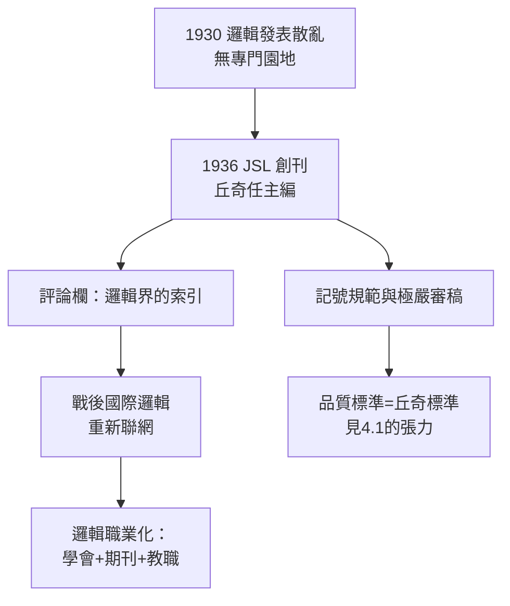

# 3.1 《符號邏輯期刊》創刊（1936）

1936 年，丘奇與一群美國及歐洲同道創立了**《符號邏輯期刊》（The Journal of Symbolic Logic, JSL）**，丘奇出任**主編**——這個位子他一坐就是將近四十年（1936–1979 參與編務），加上其後的評論總編，他實際掌控了國際邏輯發表制度超過半世紀。如果要找一個人為二十世紀邏輯學「立法」，就是他。

## 為什麼需要一份期刊

1930 年代中期，數理邏輯的發表處境荒謬：

- 邏輯論文散落在哲學、數學、數學哲學各類期刊，評審者常常看不懂；
- 美國幾乎沒有專門的邏輯發表園地；歐洲的傳統期刊（如《數學年刊》）對基礎研究態度冷淡；
- 1930 年成立的「符號邏輯學會」（Association for Symbolic Logic 的前身）亟需機關刊物。

丘奇與 Alonzo 同道的倡議者——包括 W. V. O. 蒯因（Quine，哈佛）、S. C. 克林等人——決定自建園地。1936 年《符號邏輯期刊》第一卷問世，丘奇的 1936 年〈論判定問題〉短文就發表在**創刊卷**上（見 2.1）：期刊與偉大定理同年誕生。

## 丘奇式的主編風格

丘奇主編 JSL 的四十年，塑造了整個領域的發表規範：

- **評論欄（Reviews Section）**：丘奇親自掌管書評與論文評論數十年，幾乎以一己之力寫作或審定數千則評論。邏輯界的「文献索引」長期就是丘奇的眼睛；
- **記號規範**：他規定期刊傾向統一的記號法，作者若自創符號須詳加說明——這是「記號立法」（見 1.1、2.3）的制度化；
- **極端的審稿嚴格**：傳說中他會親自**逐行驗算**投稿中的每個證明；錯誤不分大小一律退稿重寫；
- **長期主義**：他不追逐潮流，确保 1950–70 年代遞迴論、模型論、證明論的冷門工作都有發表出口。

這種作法有代價：JSL 以「退稿率高、修改週期長」聞名，年輕人抱怨投給丘奇「像把論文交給法官」。但無人否認：**通過丘奇審查的論文，四十年後仍站得住**。

## 制度與科學的共生

JSL 的成立改變了邏輯學的社會結構：

- **職業化**：邏輯學者有了專屬身份（學會＋期刊），開始在數學系獲得正當教職；
- **戰時的延續**：二戰期間（見 3.2）期刊幾乎停擺，但丘奇保住了它的連續性；
- **評論制度**：丘奇的評論欄成為日後《數學評論》（Mathematical Reviews, 1940 創刊）邏輯部分的範式；
- **國際樞紐**：戰後歐洲邏輯（波蘭學派、荷蘭、義大利）經 JSL 重新接入國際網絡。

## 事件關聯與前因後果

| 年份 | 事件 | 後續影響 |
|------|------|----------|
| 1930 | 符號邏輯學會成立 | 期刊的制度基礎 |
| 1936 | JSL 創刊，丘奇主編 | 丘奇 1936 論文發表於創刊卷（見 2.1） |
| 1936–79 | 丘奇主持編務與評論欄 | 全域記號與品質規範 |
| 1940 | 《數學評論》創刊 | 丘奇式評論成為範式 |
| 1950s–70s | JSL 承載遞迴論/模型論 | 領域職業化完成 |

**因果**：哥廷根被戰火摧毀後（→ 詳見《希爾伯特傳記》的結局），世界需要一個新的邏輯制度中心。普林斯頓供給了人（見 1.3、3.3），JSL 供給了**舞台與規則**。丘奇身兼裁判與選手：他在自家期刊上發表判定問題的否定答案（1936），又用同一期刊執行此後四十年的品質壟斷——這在科學史上極為罕見，而邏輯學因它受益。

## 小結

- JSL 是丘奇繼定理之後的第二項偉大作品：**制度**；
- 評論欄、記號規範、逐行驗算的審稿，使「丘奇標準」成為國際標準；
- 期刊與 1936 年不可解性定理同年誕生，象徵理論與制度的共生；
- 主編職位的另一面是時間與權力的代價：退稿的學生將在 1950 年代組成「造反」的一代（見 4.1）；
- 而在期刊創刊的同一年，另一場戰爭的陰影已經逼近——丘奇將以另一種方式為國家服務（見 3.2）。

**下一段**：二戰期間，這位純理論家如何為海軍計算彈道、接觸密碼學——請見 3.2。
