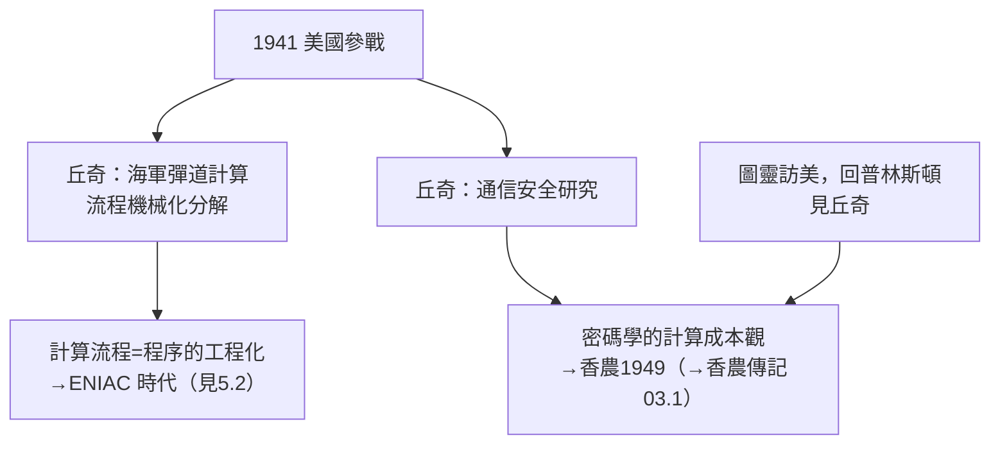

# 3.2 二戰為海軍研究彈道與密碼（1941–1946）

1941 年 12 月美國參戰後，普林斯頓的純理論學者紛紛被徵召服務國家。丘奇——這位最抽象的邏輯學家——在戰時為**海軍**從事了應用研究，主題包括**外彈道計算**與**密碼分析**。這段經歷雖低調，卻在兩條線上影響了戰後世界：計算的工程化，以及他與圖靈之間戰時情報合作的暗線。

## 彈道研究實驗室

戰時，丘奇在普林斯頓參與海軍資助的**彈道研究實驗室（Ballistic Research Laboratory, BRL）相關工作**：

- 火炮射表（firing tables）需要求解彈丸飛行的**非線性微分方程**，在計算機問世前，這靠大批「計算員」（computers——當時是職業名稱，多為女性數學工作者）手工推算；
- 丘奇的角色是**數值方法與表格化**的組織：把計算流程分解成可由未受訓人員機械執行的步驟——這正是「有效可計算性」思想的工程化身（見 2.1）；
- 同一時期，賓州大學的 BRL 分部因射表計算量爆炸而開始建造 **ENIAC**——丘奇所定義的「機械可執行的程序」即將變成鋼鐵與真空管（見 5.2）。

## 密碼分析

丘奇戰時另一項任務涉及**密碼學**。具體細節受保密限制，史載他參與了與海軍通信安全相關的研究，並與華盛頓的海軍通信部門有聯繫：

- 密碼分析本質上是**可計算性與複雜性的實戰**：一個加密系統的安全性，就是「破解程序的計算成本」；
- 戰時英國布萊切利園的圖靈破解了恩尼格瑪（→ 詳見《圖靈傳記》第 3 章），香農則在貝爾實驗室做密碼數學並於 1945 年寫出《保密系統的通信理論》（→ 詳見《香農傳記》03.1）——丘奇的可計算性理論為這條戰線提供了概念地基；
- 戰後 1949 年，香農發表該文於《貝爾系統技術期刊》，密碼學正式數學化。丘奇的貢獻在於更底層的問題：**什麼是機械上可算的，什麼不可算**——破譯與反破譯都在這條線上劃界。

## 圖靈在普林斯頓的戰時往來

1938 年圖靈取得普林斯頓博士後返回英國，旋即加入布萊切利園。戰時及戰後，圖靈多次赴美執行情報任務（包括 1942–43 年訪問貝爾實驗室，與香農共進午餐——→ 詳見《香農傳記》03.1）：

- 圖靈在美國期間曾回到普林斯頓拜訪丘奇，討論**語音加密與可計算性**；
- 師生二人一個在密碼實戰前線、一個在後方研究崗位，共同見證了同一件事：**計算理論已經成為國家級戰略資源**；
- 這段經歷深深影響圖靈戰後的選擇——造真正的機器（ACE，→ 詳見《圖靈傳記》第 4 章）。

## 與馮紐曼戰時工程的分岔

同在普林斯頓的馮紐曼戰時走向曼哈頓計畫與 EDVAC 報告（→ 詳見《馮紐曼傳記》），把可計算性直接物質化為電腦。三人戰後的分工耐人尋味：

| 人物 | 戰時崗位 | 戰後方向 |
|------|----------|----------|
| 馮紐曼 | 曼哈頓計畫 | 電腦架構、賽局論（→ 詳見《馮紐曼傳記》） |
| 圖靈 | 布萊切利園 | 硬體與 AI 藍圖（→ 詳見《圖靈傳記》） |
| 丘奇 | 海軍彈道與密碼 | 回歸純邏輯、期刊與學生（見 3.1、3.3） |

## 事件關聯與前因後果

| 年份 | 事件 | 後續影響 |
|------|------|----------|
| 1941 | 美國參戰，學者總動員 | 丘奇轉入戰時研究 |
| 1942–45 | 海軍彈道計算組織 | 「把證明寫成程序」的工程經驗 |
| 1943 | 圖靈訪美，拜會舊師 | 情報視野下的計算理論交流 |
| 1945 | 戰爭結束，ENIAC 問世前夕 | 理論—工程合流（見 5.2） |
| 1946 | 丘奇重返普林斯頓教席 | 帶著工程直覺回到邏輯 |

**因果**：1936 年丘奇在紙上定義了「程序」；1944 年他在彈道實驗室裡**管理程序**——讓數百名計算員像圖靈機一樣按步驟執行。這場戰爭證明了他的抽象概念具有物質力量：可計算的東西真的可以算，而且值得用整個國家的資源去算。戰後電腦的誕生，不過是這個認識的工程兌現（見 5.2）。

## 小結

- 戰時丘奇服務於海軍彈道與通信安全研究，把「有效可計算」從定理變成管理實務；
- 密碼分析的成敗繫於計算成本，預示了日後**複雜性理論**的核心問題（見 5.2）；
- 與圖靈的戰時往來（以及圖靈—香農在貝爾實驗室的交會）構成情報—計算—資訊三大革命的暗線；
- 馮紐曼造機器、圖靈想機器、丘奇**定義**機器——三人的戰後分工確定了計算機科學的三層結構；
- 1946 年丘奇回到普林斯頓，最龐大的產品不在實驗室，而在他的**課堂**——下一節走進那間研討班（見 3.3）。

**下一段**：圖靈、克林、羅瑟、Curry——丘奇門徒的群像與 Lambda 演算的兄弟傳統——請見 3.3。
