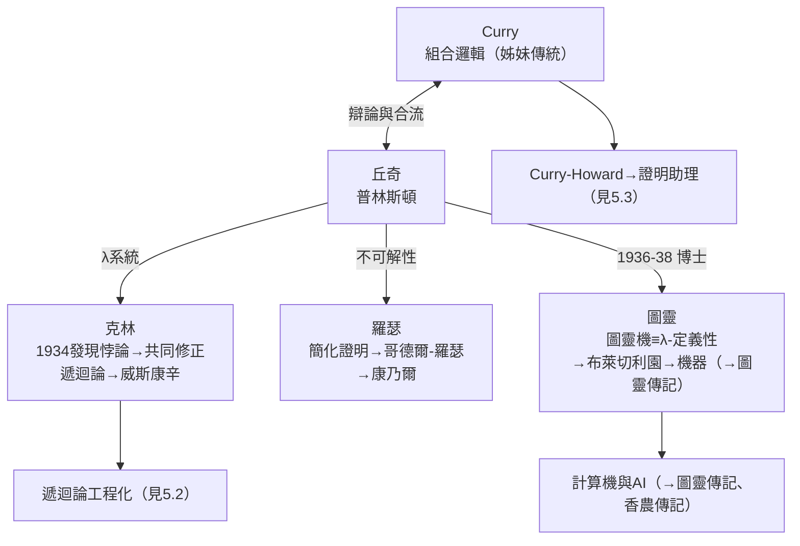

# 3.3 學生群像：圖靈、克萊尼、羅瑟與 Curry（1930s–1940s）

普林斯頓 1930 年代的邏輯課堂，是世界思想史上密度最高的房間之一。丘奇在這裡指導了**圖靈**、**克林（Stephen Cole Kleene）**、**羅瑟（J. Barkley Rosser）**，並與**Haskell Curry** 的組合邏輯傳統長期互動。本節描繪這張師生網絡，以及每條支線如何把丘奇的思想帶向不同的世紀末。

## 克林：Lambda 演算的共同鍛造者

克林是丘奇最早、最親密的學術夥伴：

- 1931 年起師從丘奇，1934 年在**檢驗丘奇的 λ 系統時發現了悖論**——系統允許構造出矛盾的表達式；
- 這次「學生打臉老師」沒有變成災難，反而變成方法：師生合力把系統限縮，保留核心，最終得到作為計算模型成立的 **λ-可定義函數**；
- 1936 年兩人合著〈論形式邏輯中的一些定理〉，證明 λ-可定義性與其他可計算性刻畫的等價；
- 克林後來在威斯康辛寫出 1952 年的《元數學導論》，把丘奇學派的標準傳向全世界（見 2.3），並發展出**遞迴論**的主要技術（見 5.2）。

## 羅瑟：更短的證明

羅瑟 1936 年也做出關鍵貢獻：

- 他把丘奇 1936 年不可解性論證改造為**更直接、更短的證明**（Rosser trick），並以同樣手法簡化了哥德爾不完備定理——**哥德爾-羅瑟定理**由此得名；
- 羅瑟風格與丘奇相反：快、猛、直接。丘奇逐行驗算的審稿在他身上遇見了最大的挑戰者；
- 羅瑟後來執教康乃爾，培養出下一代的邏輯與計算理論人才。

## 圖靈：最著名的博士生

圖靈 1936 年帶著〈論可計算數〉的手稿來到普林斯頓，成為丘奇的博士學生（1936–1938）：

- 邏輯上兩人已互為知音：圖靈證明了 λ-可定義性與圖靈機等價（見 2.1），並在普林斯頓期間發表 〈關於序數的邏輯系統〉，研究**序數邏輯**；
- 丘奇指導圖靈完成博士論文——這篇論文引入了今日所稱的**圖靈等價分層**與序數邏輯系統，是超窮遞迴論的遠源；
- 生活中兩人性格天差地別：丘奇沉靜如僧侶，圖靈古怪而直率。系裡的調侃是：「圖靈論文的參考文獻比正文還像丘奇寫的」；
- 1938 年圖靈獲博士學位，隨即返回英國走向戰爭與機器（→ 詳見《圖靈傳記》第 3、4 章）。

## Curry：姊妹傳統

**Haskell Curry** 嚴格說不是丘奇的學生，而是 Lambda 演算的**兄弟傳統**創始人：

- Curry 在 1920–30 年代獨立發展**組合邏輯（combinatory logic）**：不用變數、只用組合子的函數系統，目標同樣是改進《數學原理》的記號；
- 丘奇與 Curry 及克林在 1930 年代反覆通信辯論：誰的系統更基本、誰的記號更經濟；
- 最終兩個系統被證明表達力等價；而 **Curry–Howard 對應**（證明即程式）從 Curry 一側出發，日後與丘奇的型別理論合流成證明助理的基礎（見 5.3）；
- 有趣的後世回聲：函數式語言 **Haskell** 的名字致敬 Curry，而它的型別系統血統來自丘奇（見 5.1）。

## 事件關聯與前因後果

| 年份 | 事件 | 後續影響 |
|------|------|----------|
| 1931–34 | 克林師從丘奇，發現 λ 系統悖論 | 系統修正，可計算性定義穩固 |
| 1936 | 羅瑟簡化丘奇證明 | 哥德爾-羅瑟定理 |
| 1936–38 | 圖靈在普林斯頓攻讀博士 | 兩大可計算性定義會師（見 2.1） |
| 1930s | 丘奇–Curry 組合邏輯辯論 | 證明即程式的伏筆（見 5.3） |
| 1940s–50s | 門徒散布各校 | 美國邏輯學派主導世界（見 2.3） |

**因果**：丘奇 1934 年的悖論如果不是被克林發現，λ 系統可能作為錯誤理論被棄置；如果不是丘奇嚴格保留核心而非全盤推翻，1936 年的定義不會存在；如果圖靈沒有讀到丘奇 1936 年的論文，〈論可計算數〉或許不會以同樣的形式完成。**這個學派的本質是一臺「互相找錯」的機器**——老師與學生互為對方的檢查程序，而錯誤每次被找到，理論就升一級。

## 小結

- 克林貢獻了**修正與系統化**（λ 悖論→遞迴論）；羅瑟貢獻了**銳化**（更短的證明）；圖靈貢獻了**另一種語言**（機器）並回頭確認了丘奇的定義；Curry 貢獻了**姊妹系統**與「證明即程式」的種子；
- 丘奇學派的成功公式：極端嚴格＋學生被允許（甚至被期待）找老師的錯；
- 這張網絡在 1950 年代覆蓋美國（見 2.3），在 1980 年代覆蓋函數式程式設計（見 5.1）；
- 但嚴格文化也會累積張力——1960 年代，丘奇自己的課堂上爆發了學生的「造反」（見 4.1）。

**下一段**：造反的學生、「丘奇的嚴格」的代價，以及他獨特的博士生指導風格——請見 4.1。
