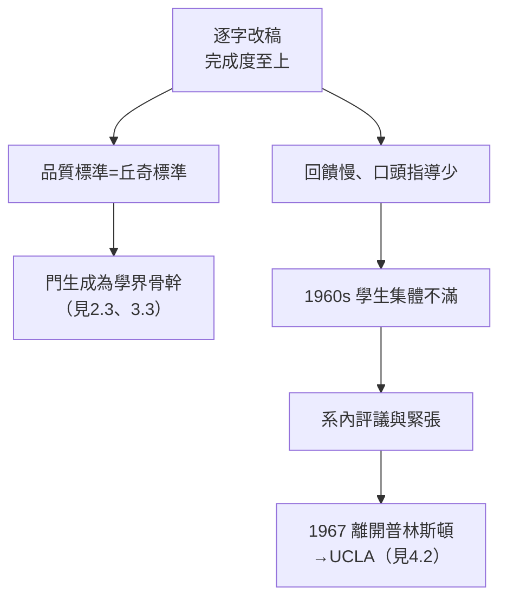

# 4.1 造反的學生與「丘奇的嚴格」、博士生指導風格（1950s–1960s）

到了 1960 年代，普林斯頓的丘奇研討班出現了一個著名現象：**一整批最優秀的學生「造反」**——不是造邏輯的反，而是造丘奇指導方式（或其缺失）的反。這段歷史既 exposing 又深刻：它顯示「嚴格」這種美德在學術加速時代遇到的結構性張力。

## 「丘奇的嚴格」是什麼

丘奇的指導風格在學生口中高度一致：

- **逐字改稿**：博士論文初稿會被改到面目全非，學生常說「最後的論文有一半是他的句子」；
- **完成度至上**：他不允許「差不多」的證明——每個引理要寫到可機械檢查的程度，正如他自己 1936 年論文的標準（見 2.1）；
- **寡言的討論**：丘奇在討論中極少發表意見，學生提問往往只得到一句「你可以看看 Kleene 的書」——然後是漫長的等待；
- **記號潔癖**：他要求學生先用三頁定義記號，再開始證明（見 2.3）。

這種風格造就了驚人的品質，但也有代價：**論文周期極長、學生的原創聲音被壓縮**。

## 造反的一代

1960 年代中期，一批普林斯頓邏輯博士生集體以行動表達不滿，其中最著名的是 **Bill Howard、James Baumert、Plew** 等人（史稱「丘奇門下的異議者」事件，或依傳記作家記載為 **Donald Martin、M. Rubin、P. Andrews 等人的辭退事件**）——核心事實是：**多位博士生聯名或私下向系裡抱怨丘奇的指導，甚至有學生直接轉系、轉校**：

- 抱怨集中在兩點：**回饋太慢**（學生等數月得不到一句評語）與**無口頭指導**（丘奇不開會、不聊進度）；
- 系裡為此召開評議，丘奇的反應符合其一貫作風：不辯解、不改變——他認為「寫作本身就是指導」；
- 結果是分手：丘奇 1967 年離開执教三十八年的普林斯頓，遠走加州（見 4.2）。這場遷移的導火線之一，正是師生關係的緊張與系內氛圍的變化。

歷史的公允之處在於：那些「造反」的學生，多年後幾乎眾口一詞地承認——**丘奇改過的稿子讓他們終身受益**。美國邏輯學會後來的多位主席出自他的門下（見 3.3）。

## 指導風格的兩面性

| 優點 | 代價 |
|------|------|
| 品質極高：門生論文半世紀後仍被引用 | 週期極長：一篇博士論文常耗五至七年 |
| 記號與證明的職業標準 | 學生原創聲音被覆蓋 |
| 終身的智力忠誠（他持續讀門生論文數十年） | 情感距離：極少人與他有私人友誼 |
| 拒絕學術政治，保護研究自由 | 在系務鬥爭中不善自保（見 4.2） |

## 事件關聯與前因後果

| 年份 | 事件 | 後續影響 |
|------|------|----------|
| 1929–60s | 普林斯頓三十八年執教 | 學派成型（見 2.3、3.3） |
| 1950s | 指導量增大、回饋變慢 | 不滿累積 |
| 1960s 中 | 多名博士生公開抱怨或轉系 | 「造反」事件 |
| 1967 | 丘奇離開普林斯頓轉赴 UCLA | 見 4.2 |
| 1970s–90s | 門生回顧：恩怨兩存 | 評價逐漸公允 |

**因果**：丘奇的嚴格是 1936 年定義可計算性那種「把每步寫到底」的作風在人事上的延伸（見 2.1）——它製造了偉定理論，也製造了無法规模化的人事摩擦。同一時代，戰後大學急速擴張、博士生成倍增長，「工匠式」一對一打磨遇上「量產式」研究生院，衝突幾乎是必然的。丘奇的選擇是不妥協：與其降低標準，不如換一座城。

## 小結

- 「丘奇的嚴格」＝逐字改稿＋完成度至上＋記號潔癖，是丘奇學派品質的來源也是張力的來源；
- 1960 年代學生的集體不滿是真實的，門生事後的感激也是真實的——兩者並存；
- 這場張力直接導致他 1967 年的西遷；
- 與同代導師對照：馮紐曼以魅力統軍（→ 詳見《馮紐曼傳記》），丘奇以手稿統軍——前者打造了團隊，後者打造了**標準**；
- 1967 年，六十四歲的丘奇橫越美國，人生最後的長篇章在加州展開（見 4.2）。

**下一段**：轉往 UCLA 的決定、加州的教學歲月與哲學邏輯的新土壤——請見 4.2。
