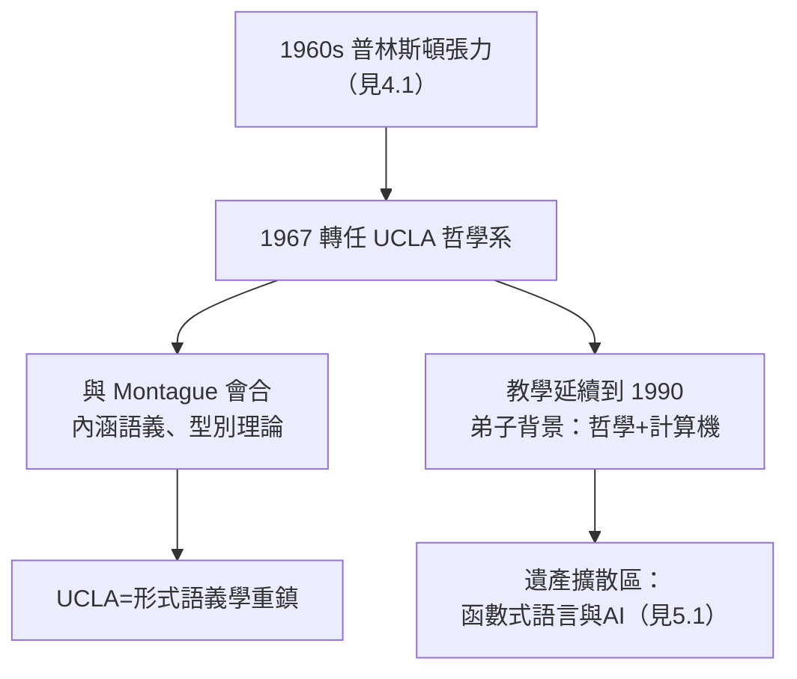

# 4.2 轉往 UCLA（1967）

1967 年，六十四歲、在普林斯頓執教三十八年的丘奇做了職業生涯最大的一次地理決定：**離開新澤西，轉任加州大學洛杉磯分校（UCLA）哲學系教授**。這一步出人意料——全世界都以為他會在普林斯頓終老——卻又是他一生性格的必然：寧可搬家，不肯彎腰。

## 為什麼是 UCLA、為什麼是哲學系

這次遷移是多重力的合量：

- **普林斯頓的疲態**：1960 年代師生緊張（見 4.1）、數學系重心轉向分析與拓撲，邏輯在系的內部位階下降；年輕同事與他的嚴格文化格格不入；
- **加州的邀請**：UCLA 正在把哲學系建成全美邏輯重鎮，Richard Montague（蒙太格，形式語義學創始人）等邏輯取向的哲學家已在此任教；
- **哲學邏輯的召喚**：丘奇晚年興趣日益偏向**內涵語義（intensional semantics）**、必然性與分析性——這些問題的天然歸宿是哲學系；
- **氣候與環境**：纯粹而實際的理由——普林斯頓的冬天對這位高齡的健行愛好者愈來愈不友善。

UCLA 給他的不只是職位，而是一個**把邏輯當作哲學核心**的社群——這正是丘奇從 1930 年代起就被數學系視為「太哲學」、被哲學系視為「太數學」的一生所期待的第三方位置。

## 蒙太格與內涵語義的會合

丘奇與 Montague 的關係是 UCLA 歲月最富成果的化學反應：

- Montague 語法把自然語言片段翻譯成**內涵邏輯**——其核心工具之一正是丘奇 1940 年的簡單型別理論（見 2.2）；
- 丘奇自 1940 年代起就發展**內涵性理論**：區分外延（extension，函數的值表）與內涵（intension，函數的概念）——他提出以「個體概念函數」處理「晨星＝暮星」這類弗雷格難題（→ 詳見《弗雷格傳記》）；
- 師友同處一系，使 UCLA 在 1970 年代成為**形式語義學**的世界中心之一；
- 當代語言學中「意義即類型化函數」的範式，血統上同時來自 Montague 與丘奇。

## 晚年的教學

在 UCLA，丘奇教到 1990 年、七十九歲時才正式退休（1990 年榮退，仍偶爾授課）：

- 他繼續開設型別理論、遞迴論與哲學邏輯課程；
- 與普林斯頓不同，加州學生多以哲學與電腦科學為背景——他們問的問題（程式語言、語義、人工智慧）恰好落在丘奇遺產的擴散區（見 5.1）；
- 1985 年前後，他將畢生藏書與論文檔案整理捐贈給普林斯頓與 UCLA，為史家留下了「丘奇檔案」；
- 榮譽在此期密集到來：1978 年入選英國國家學術院對應院士、獲多所大學榮譽博士，並於 1985 年後逐步交出《符號邏輯期刊》的編務（見 3.1）。

## 事件關聯與前因後果

| 年份 | 事件 | 後續影響 |
|------|------|----------|
| 1967 | 離普林斯頓赴 UCLA | 哲學邏輯新階段 |
| 1967–70s | 與 Montague 同系 | 形式語義學的型別基礎 |
| 1970s | 發展內涵性與個體概念理論 | 弗雷格意義難題的現代處理 |
| 1990 | 高齡榮退 | 史上最長教學生涯之一 |
| 1985–90s | 捐贈檔案、交出編務 | 「丘奇檔案」傳世 |

**因果**：普林斯頓提供了理論與學派（第 2、3 章），UCLA 提供了**哲學的歸宿**。如果沒有 1967 年西遷，丘奇的型別理論可能停留在數學邏輯內部；有了 UCLA 的語義學土壤，它直接參與了自然語言形式化的革命——並在三十年後，經由程式語言與證明助理回到計算機科學的主戰場（見 5.3）。

### 與圖靈晚年之路的對照

| | 圖靈 | 丘奇 |
|--|------|------|
| 職業遷移 | 劍橋→曼徹斯特（→《圖靈傳記》第 4 章） | 普林斯頓→UCLA |
| 晚年主題 | 形態發生、AI 迫害 | 內涵語義、哲學邏輯 |
| 結局 | 1954 年悲劇離世 | 1995 年高齡善終 |
| 身後地位 | 同性戀平反、電腦之父 | 函數式程式與型別論之父 |

同一位導師的兩位門生，走向了二十世紀最對照的兩種結局。

## 小結

- 1967 年西遷是性格的必然：**寧可離開，不肯降低標準**；
- UCLA 的哲學系土壤讓丘奇的型別理論與 Montague 語法合流，催生形式語義學；
- 晚年教學延續至 1990 年，培養出哲學與計算機背景的新一代門生；
- 丘奇的一生因此分成三段：普林斯頓求學（第 1 章）、普林斯頓立法（第 2、3 章）、加州播種（本節與 4.3）；
- 最後的十年，他在榮譽與平靜中等待歷史的兌現——那個 1936 年被證明「不可解」的世界，正在變成所有人的生活（見 4.3）。

**下一段**：晚年、哲學邏輯的最後工作與 1995 年的落幕——請見 4.3。
