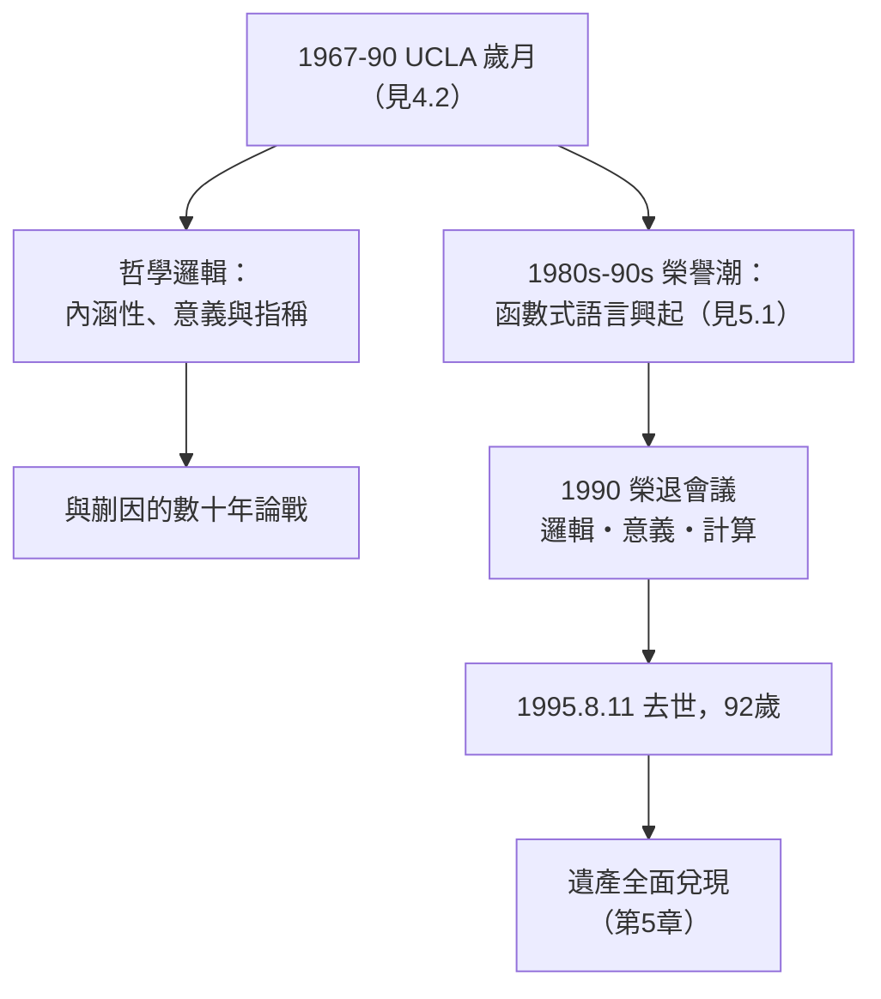

# 4.3 晚年、哲學邏輯與去世（1990–1995）

丘奇生命的最後十年，是在洛杉磯的陽光、不斷湧來的榮譽、以及一場遲到的歷史加冕中度過的。他逝世於 1995 年 8 月 11 日，享耆壽九十二歲——幾乎活到自己 1936 年定義的概念占領全世界的那一天（見 5.1–5.3）。

## 哲學邏輯的最後工作

丘奇晚年的學術重心是**內涵邏輯與意義理論**：

- 他長期堅持弗雷格式的立場：**意義（Sinn）與指稱（Bedeutung）必須區分**（→ 詳見《弗雷格傳記》），並在多篇論文與書評中用「個體概念」（individual concepts）的形式工具處理信念語句、必然性等難題；
- 他與蒯因就「分析性」「模態邏輯的地位」有數十年筆戰（→ 另見《維根斯坦傳記》中的分析性論爭背景）：蒯因懷疑模態概念，丘奇則相信它們可以被嚴格形式化——後來可能語義學的勝利部分站在丘奇一邊；
- 他持續為《符號邏輯期刊》寫評論直到年近九十，最後一篇評論於 1990 年代初發表——**主編兼評論員的身分跨越六十餘年**（見 3.1）。

## 遲到的加冕

1980–90 年代，函數式程式設計（見 5.1）與型別論（見 5.3）興起，丘奇成為計算機科學界的活文物：

- **1985 年**前後，多所大學授予榮譽博士學位；邏輯、計算機科學與哲學三界同時向他致敬；
- 1990 年，**丘奇八十壽辰暨榮退學術會議**在 UCLA 舉行，圖靈獎級與哲學界的學者齊聚——會議論文集題為《邏輯、意義與計算》（*Logic, Meaning and Computation*），三個詞正好是他一生三個戰場；
- 學界開始系統地使用「**丘奇-圖靈論題**」稱呼 1936 年的共識（見 2.1），丘奇的名字被放回本來就屬於他的位置；
- 1995 年他獲選為**計算機學會（ACM）歷史人物**表彰的對象之一——比圖靈獎的設立晚了三十年，但邏輯學家們都明白誰是更早的那一位。

## 最後的日子與去世

晚年的丘奇保持著兩個習慣直到最後：**長距離健行**與**每日閱讀論文**。學生回憶九十歲的他在加州丘陵間健行的速度讓年輕人跟不上。1995 年 8 月 11 日，丘奇在俄亥俄州（探親途中）平靜去世。他的身後事符合其一貫作風：**安靜、無儀式感、只留作品**。

他的妻子瑪麗（Mary, née Deutsch，1934 年結婚）與子女數十年來是他沉默的後盾。家族的「法官—規則」傳統（見 1.1）在第三代依然延續：精確、克制、以工作代替言語。

## 事件關聯與前因後果

| 年份 | 事件 | 後續影響 |
|------|------|----------|
| 1985 前後 | 榮譽博士與三界致敬 | 歷史定位確立 |
| 1990 | UCLA 榮退暨壽辰會議 | 《邏輯、意義與計算》結集 |
| 1990s 初 | 最後一篇 JSL 評論 | 六十年評論生涯謝幕 |
| 1995.8.11 | 於俄亥俄去世，享年 92 | 遺產進入全面兌現期 |
| 2000s | 函數式語言與證明助理爆發 | 見 5.1、5.3 |

**因果**：丘奇去世時（1995），Java 剛問世、萬維網正在起飛——他定義的「計算」已成為人類文明的基底設施（見 5.2）。他沒能看到 Coq 完成四色定理的形式化證明（2005）、沒能看到 Haskell 進入工業界、也沒能看到 Lean 數學家圖書館的百萬行形式數學（見 5.3）。但這些全是 1936 年（見 2.1）與 1940 年（見 2.2）兩篇論文的直接後代。

### 同代人的謝幕序列

| 人物 | 去世 | 留下的核心遺產 |
|------|------|----------------|
| 馮紐曼 | 1957 | 電腦架構（→《馮紐曼傳記》） |
| 圖靈 | 1954 | 機器與 AI 藍圖（→《圖靈傳記》） |
| 香農 | 2001 | 資訊理論（→《香農傳記》05.3） |
| 丘奇 | 1995 | 可計算性、Lambda、型別 |
| 哥德爾 | 1978 | 不完備定理 |

五人之中，丘奇活到第五長，卻是唯一**親眼看到自己的抽象概念變成日常技術**的理論奠基者之一。

## 小結

- 晚年丘奇在哲學邏輯（內涵、意義）上持續工作，與蒯因的論戰貫穿半世紀；
- 榮譽在 1980–90 年代全面到來，1990 年的榮退會議是三界（邏輯、哲學、計算機）的合流致敬；
- 1995 年 8 月 11 日去世，九十二歲，安靜謝幕；
- 他的一生可以壓縮成一句話：**1936 年他在紙上定義了「計算」，六十年後人類活在了這個定義裡**；
- 第 5 章將追蹤這個定義的三條兌現之路：函數式語言（5.1）、可計算性的工程化（5.2）、證明助理（5.3）。

**下一段**：Lambda 演算如何在 LISP、ML、Haskell 中復活，成為函數式程式語言的根基——請見 5.1。
