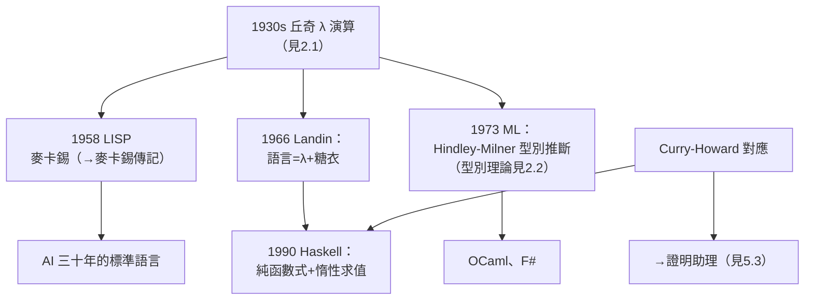

# 5.1 Lambda 演算成為函數式程式語言根基（1958–1990）

丘奇 1930 年代發明的 Lambda 演算，在誕生後二十多年裡只是邏輯學的小眾工具。1958 年起，它開始了數學史上罕見的轉世：**從基礎研究的符號系統，變成真實程式語言的語法核心**。到 1990 年，它已是整個函數式程式設計（functional programming）傳統的 DNA。

## 第一轉世：LISP（1958）

1958 年，MIT 的**約翰·麥卡錫**（→ 詳見《麥卡錫傳記》）設計 LISP 時，直接借用了丘奇的記號：

- LISP 的函數定義語法 `LAMBDA`，就是 $\lambda x.\,M$ 的 ASCII 化——`(lambda (x) ...)`；
- 麥卡錫的學生 Steve Russell 意識到：`eval` 函數本身可以寫成程式——**直譯器（interpreter）誕生**，Lambda 演算第一次「跑」在機器上；
- 遞迴、一級函數（函數可當參數傳遞）、垃圾回收——LISP 的三大發明中，前兩者都是 Lambda 演算特性的工程化；
- LISP 成為 1958 年後三十年 AI 研究的標準語言（→ 詳見《麥卡錫傳記》《香農傳記》04.2 達特茅斯會議的脈絡）。

## 第二轉世：ISWIM 與 ML（1960s–1970s）

- **Peter Landin** 1966 年的 ISWIM 論文〈The Next 700 Programming Languages〉證明：大多數程式語言只是 Lambda 演算加上一層糖衣；
- **Robin Milner** 在愛丁堡為定理證明器 LCF 設計了 **ML** 語言（1973），其**型別推斷（Hindley–Milner 型別系統）**直接來自丘奇簡單型別理論的自動化（見 2.2）——型別不必標註，系統自己推導；
- ML 之後分裂出 Standard ML、OCaml、F#——整個 ML 家族的語義基礎都是 Lambda 演算。

## 第三轉世：Haskell 與純函數式（1980s–1990）

- 1987 年，一群研究者決定統一眾多惰性函數式語言，誕生 **Haskell**（1990 年首版）；
- Haskell 的設計核心是**純度**：函數無副作用，一切計算是表示式的求值——這正是丘奇「一切由代入（β-歸約）生成」的原始信條（見 2.1）；
- **惰性求值（call-by-need）**對應 Lambda 演算的不同歸約策略——丘奇與克林 1930 年代研究的歸約順序問題（normal order vs applicative order），五十年後成為語言實作的工程決策；
- Haskell 以 Haskell Curry 命名（見 3.3），而其型別類（type class）系統的血統仍是丘奇的型別理論。

## Curry–Howard：證明即程式

貫穿三轉世的深層結構是 **Curry–Howard 對應**：

| 邏輯 | 程式 |
|------|------|
| 命題 | 型別 |
| 證明 | 程式（λ 項） |
| 證明化簡 | 求值（β-歸約） |

寫一個型別正確的程式＝給出一個構造性證明。這條對應把丘奇的型別理論（2.2）、Curry 的組合邏輯（3.3）與直覺主義的構造性傳統（1.3）焊接成一體，成為見 5.3 證明助理大廈的地基。

## 事件關聯與前因後果

| 年份 | 事件 | 後續影響 |
|------|------|----------|
| 1958 | LISP 引入 LAMBDA 與直譯器 | 函數式傳統誕生 |
| 1966 | Landin「下一個 700 種語言」 | λ 作為語言通用語義 |
| 1973 | ML 與型別推斷 | 型別論工程化 |
| 1978 | Backus 圖靈獎演說〈函數式程式設計能否從馮紐曼風格中解放〉 | 函數式範式獲主流認可 |
| 1990 | Haskell 1.0 | 純函數式集大成 |

**因果**：麥卡錫在達特茅斯會議（1956，→ 詳見《香農傳記》04.2、麥卡錫傳記）上提出「智慧可被形式描述」——而描述的工具他選了丘奇的 λ。Backus 1978 年的圖靈獎演說把函數式風格推向主流，其理論根據正是「程式＝數學表示式」的丘奇式觀點。**LISP 給了 λ 生命，ML 給了 λ 型別，Haskell 給了 λ 純度**——三次轉世，同一具骨架。

## 小結

- Lambda 演算經由 LISP（1958）進入機器，經由 ML（1973）獲得型別推斷，經由 Haskell（1990）達到純函數式的完型；
- Curry–Howard 對應把「程式即證明」變成可執行的技術路線；
- 丘奇 1930 年代的記號癖（見 1.1）最終統治了程式語言設計的美學：一級函數、閉包、不可變性、組合子——今日 JavaScript、Python、Rust、Swift 中的 `lambda`/`=>`/`fn` 全是他的記號的後裔；
- 函數式只是第一條兌現之路；第二條是「不可計算」觀念的工程化——複雜性理論與停機問題（見 5.2）。

**下一段**：遞迴論、停機問題如何長成可計算性理論，並工程化為現代計算的邊界碑——請見 5.2。
