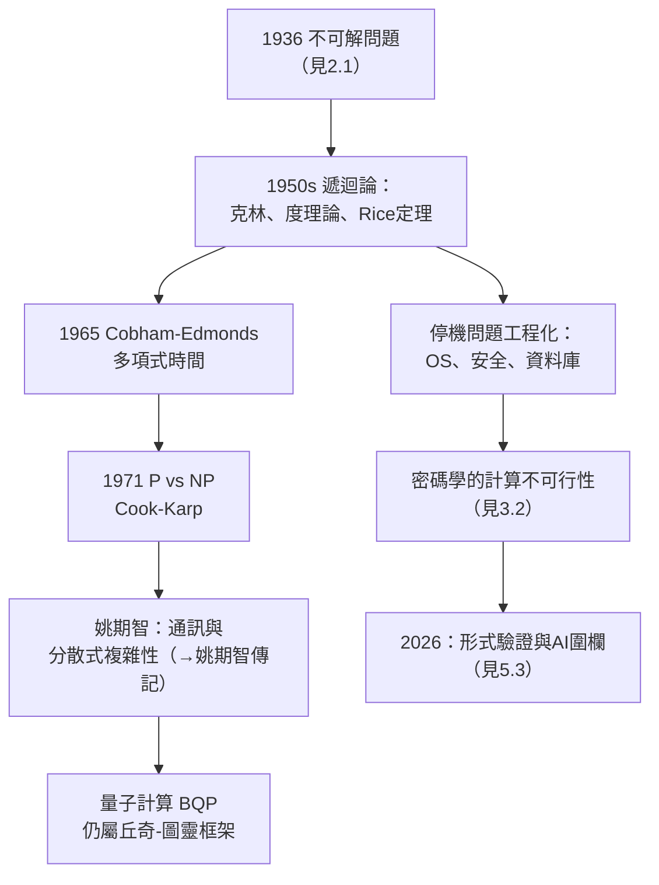

# 5.2 遞迴論、停機問題與可計算性理論的工程化（1950–2026）

1936 年丘奇證明了「存在不可解的問題」（見 2.1）；1950 年代起，這個否定性結果生長為整門**可計算性理論（遞迴論）**；再過三十年，它被**工程化**——成為作業系統、資料庫、密碼學與程式語言中真實存在的邊界碑。本節追蹤從克林到姚期智、從停機問題到現代系統的因果鏈。

## 遞迴論的成形（1950s）

克林（見 3.3）與波蘭、俄國學派在戰後把丘奇 1936 年的單點突破系統化：

- **克林 1952 年《元數學導論》**確立了遞迴函數論的標準架構（見 2.3）；
- **克林與 Post 的度（degrees）理論**：不可解問題有「多難」之分——圖靈度、算術階層 $0', 0'', \ldots$ 把「不可計算」變成可分級的對象；
- **Rice 定理**（1951）：任何非平凡的語義性質都不可判定——這是丘奇 1936 年定理的推廣，日後成為編譯器與靜態分析的第一戒律；
- 丘奇本人的角色退居標準制定者：他在 JSL 的評論欄中為每一項進展蓋章（見 3.1）。

## 停機問題的工程化身

圖靈證明的**停機問題**（不存在程序判定任一程式是否停機，→ 詳見《圖靈傳記》02.1）在工程中無處不在：

- **作業系統**：死鎖偵測、行程排程——「程式會不會永遠跑下去」不可判定，只能靠啟發式與逾時；
- **資料庫與 SQL**：查詢優化是 NP 難的，近似演算法是唯一出路；
- **病毒與安全**：判定「任一程式是否惡意」不可判定——防毒軟體注定是貓鼠遊戲；
- **密碼學**：丘奇戰時的直覺（見 3.2）制度化為「計算不可行性」——不是不可計算，而是**計算上不可行**。

## 複雜性理論：把「可算」升級為「多快可算」

1960 年代起，問題從「能不能算」變成「要多少資源才能算」：

- **Cobham–Edmonds 定義多項式時間**（1965）：可行計算的邊界；
- **P vs NP**（Cook 1971、Karp 1972）：停機問題的「實用版」——新世紀最重要的未解問題，其表述方式（圖靈機＋多項式）完全是丘奇-圖靈框架的延伸；
- **姚期智**把通訊複雜性與分散式計算的界碑立起（→ 詳見《姚期智傳記》），其問題表述、不可行性證明技術，全部繼承自遞迴論的方法論；
- **量子計算**：量子圖靈機、BQP 複雜性類——即使物理換軌，「計算」的定義骨架仍是丘奇-圖靈的（量子計算並未超越可計算性，只改變了成本曲線）。

## 2026 年的視角

到今天，可計算性理論的工程兌現已成為文明基建：

- **形式驗證**：編譯器（CompCert）、作業系統微核心（seL4）被完整形式化——用機器檢查證明，這正是丘奇「證明可機械檢查」信條的兌現（見 5.3）；
- **AI 與可判定性**：大型語言模型不會「解決」停機問題——不可判定的依然是不可判定的，丘奇 1936 年的負結果為 AI 的能力劃出永久的圍欄；
- **程式分析**：每個現代 IDE 的「紅線提示」背後，都是 Rice 定理劃定的不可判定邊界上的啟發式舞蹈。

## 事件關聯與前因後果

| 年份 | 事件 | 後續影響 |
|------|------|----------|
| 1950–52 | 克林《元數學導論》、Rice 定理 | 遞迴論成為學科 |
| 1950s | 圖靈度與算術階層 | 「不可解」可分級 |
| 1965 | Cobham–Edmonds 可行性定義 | 複雜性理論誕生 |
| 1971–72 | P vs NP 框架 | 世紀難題 |
| 1980s–90s | 密碼學計算不可行性制度化 | 現代網路安全的基礎 |
| 2000s–2026 | 形式驗證、AI 圍欄、量子複雜性 | 丘奇框架全面工程化 |

**因果**：丘奇-圖靈論題把「機器」從工程概念升格為數學概念（見 2.1），複雜性理論再把「多快」升格為數學概念——兩次升格用的是同一方法：**把工程直覺變成可證明的形式定義**。這正是丘奇從維布倫那裡繼承的公理化方法（見 1.2）的世紀級應用。姚期智一代的複雜性學家、與 Shannon 一代將邏輯工程化為電路的人（→ 詳見《香農傳記》02.1、02.2），分別在理論與硬體兩端完成了丘奇 1936 年論文埋下的種子。

## 小結

- 遞迴論（1950s）把「不可解」系統化、分級化；
- 停機問題的不可判定性成為現代系統設計的**物理常數**：防毒、排程、靜態分析都在這條邊界上工作；
- 複雜性理論（1965–）是丘奇框架的升級版：從「可否」到「代價」；
- 2026 年的 AI 與形式驗證仍在丘奇劃定的圍欄內工作——他的負結果比任何正結果都更長壽；
- 第三條兌現之路最精緻：型別理論如何長成 Coq 與 Lean，讓數學本身變成可執行的程式——請見 5.3。

**下一段**：從丘奇的 1940 年型別到 Coq、Lean 的百萬行形式數學——請見 5.3。
