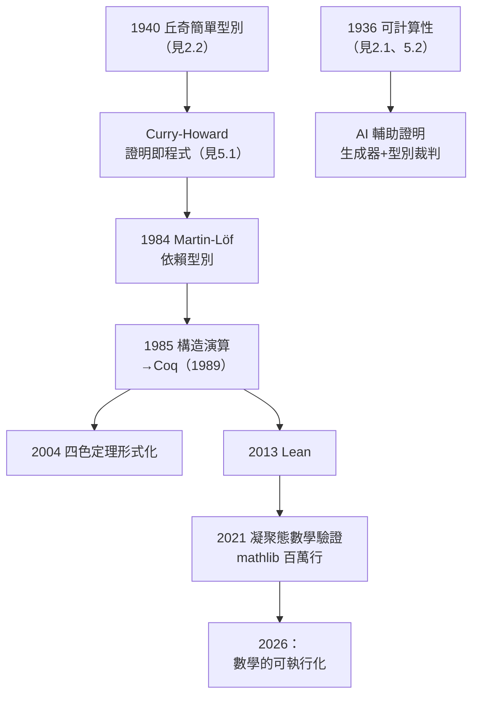

# 5.3 型別理論、證明助理（Coq、Lean）與現代影響（1980–2026）

丘奇 1940 年的簡單型別理論（見 2.2）在 1980 年代之後開始了它最精緻的轉世：**成為證明助理（proof assistant）的基礎**——讓計算機本身成為數學證明的裁判。到 2026 年，Coq、Lean、Agda 中的形式化數學已達數百萬行，而它們的語法與語義骨架，仍是 $\lambda x.\,M$ 加上一套型別。

## 從簡單型別到依賴型別

戰後型別理論的三級跳：

- **丘奇 1940**：簡單型別 $\sigma \to \tau$，一階函數分層（見 2.2）；
- **Curry–Howard 對應**（1969–1980，見 3.3、5.1）：命題即型別、證明即程式——證明變成了可以求值的對象；
- **Per Martin-Löf 的依賴型別理論**（1971–1984）：型別可以依賴值（如「長度為 n 的向量」），直覺主義的構造性傳統（見 1.3 布勞威爾的遠因）在此全面制度化；
- **Coquand–Huet 的歸納構造演算（CoC, 1985）**：把 Martin-Löf 型別論與 Girard 系統 F 統合，成為 **Coq** 的內核——它的基礎語法就是丘奇的 λ 記號的依賴版本。

## Coq 與 Lean：機器裁判的世紀

兩代證明助理把「證明可機械檢查」變成日常：

- **Coq**（1989–）：核心是型別檢查器——一個證明就是一個型別正確的 λ 項。2004 年完成**四色定理**的完整形式化（Gonthier），2009 年完成奇偶遊戲證明，2012 年 Feit–Thompson 定理形式化；
- **Lean**（2013–，Microsoft Research，Leonardo de Moura）：更快的核心、更強的巨集系統；2017 年起 **mathlib** 數學庫指數增長，2020 年代已成為前沿數學家的日常工具——Peter Scholze 的凝聚態數學（liquid tensor experiment, 2021–22）在 Lean 中完成驗證，陶哲軒（Terence Tao）等頂級數學家加入形式化行列；
- **Agda 與 HoTT**：同倫型別論（homotopy type theory, 2013）把型別論與拓撲結合——又回到維布倫式「不變關係」的品味（見 1.2）。

丘奇 1940 年「用語法規則擋住悖論」的設計（見 2.2）在這些系統中是**安全性的唯一保證**：內核只有數千行，全部是型別檢查——信任內核，就信任一切形式數學。

## 與其他傳統的合流

型別理論在 2020 年代的影響網：

- **程式語言**：Rust 的所有權系統、TypeScript 的漸進型別、Haskell 的依賴型別擴展——工業語言全面向型別論靠攏（見 5.1）；
- **密碼學與區塊鏈**：智能合約的形式驗證（Coq 驗證以太坊虛擬機、Move 語言的資源型別）——丘奇戰時的「計算不可行性」（見 3.2）與 1940 年的型別安全在此會師；
- **AI 輔助證明**：大型語言模型＋Lean 的組合正在把形式化成本降到數學家的直覺速度——但 AI 產出的每一步仍須過型別檢查器這一關。**丘奇的裁判比任何生成器都長壽**（見 5.2）；
- **卡爾納普式理想的兌現**：卡爾納普夢想的「哲學問題化為語言選擇」（→ 詳見《卡爾納普傳記》03.2）在型別論中部分成真——選擇一個型別系統，就是選擇一種知識論。

## 事件關聯與前因後果

| 年份 | 事件 | 後續影響 |
|------|------|----------|
| 1940 | 丘奇簡單型別理論 | 一切型別系統的源頭（見 2.2） |
| 1969–80 | Curry–Howard 對應精緻化 | 證明即程式的技術路線 |
| 1984 | Martin-Löf 依賴型別論 | 構造性數學可執行化 |
| 1989 | Coq 問世 | 機器裁判時代開始 |
| 2004 | 四色定理形式化 | 證明助理的里程碑 |
| 2013 | Lean 誕生 | mathlib 與數學界接受 |
| 2021–26 | AI＋形式化合流 | 型別檢查成為數學的最终裁判 |

**因果**：羅素的悖論迫使丘奇設計型別（見 2.2），Curry 的組合邏輯提供「證明即程式」的鏡像（見 3.3），Martin-Löf 把布勞威爾的構造性（見 1.3）寫成依賴型別，Coquand–Huet 把它們全部壓進一個 λ 內核。八十六年的接力，每一棒都接在丘奇 1940 年論文的語法上——**今日數學的形式化，本質上是丘奇記號的大規模部署**。

## 小結

- 型別理論經 Curry–Howard 與依賴型別，長成 Coq/Lean 的證明助理大廈；
- 四色定理、凝聚態數學的形式化證明，標誌著「機械可檢查的證明」從理論變成數學實踐；
- 2020 年代 AI 輔助證明的架構「生成器＋型別裁判」，正是丘奇-圖靈論題（2.1）與簡單型別理論（2.2）的合體應用；
- 從 1903 年華府法官之家的兒童（見 1.1），到 2026 年每一行 Lean 程式碼中的 $\lambda$——丘奇的一生證明了：**最持久的力量不是武器，而是記號**；
- 全書至此閉環：他定義了計算（2.1）、保衛了邏輯（2.2）、建立了制度（3.1）、培養了群星（3.3）、在西岸播種（4.2），而世界用八十年把他的定義兌現成文明（第 5 章）。

**全書完**——但 $\lambda x.\,x$ 的歸約，仍在每臺計算機上繼續。
