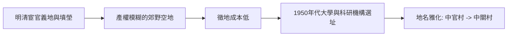

# 1.1 太監墳場與中官村的地名由來

中關村原名「中官村」，「中官」即宦官、太監。明清兩代，北京西郊海淀一帶因皇家園林密集，宮中宦官多在此置辦養老義地與墳塋，死後葬於斯，故形成太監墳場。此地地處城外荒郊，地價低廉，又鄰近皇家園囿的服務人口，遂成為宮廷底層服務者的聚葬之所。清代以降，周邊逐漸出現村莊與農田，但「中官」之名一直沿用，民國地圖上仍可見「中官村」「中官墳」等標註。

地名本身就是第一層因果：太監墳場意味著這片土地在帝制晚期沒有宗族、沒有土地廟、沒有密集的鄉紳網絡，是一塊「產權模糊、人口稀薄」的緩衝地帶。正因如此，1950年代國家在規劃新北京的科教功能時，這片地區徵地成本與拆遷阻力遠低於內城，成為布局大學與科研機構的理想選擇。舊墳場被整體遷移，「中官村」也因文人雅化而改寫為「中關村」，一個帶有關隘意象、更中性的地名。

**因果分析**：太監墳場與後來的學院區之間，存在一條土地制度驅動的因果鏈。帝制時代的邊緣功能（葬地）造就了地權的鬆散；社會主義計劃時代的城市規劃偏好空地與低成本徵地；兩者疊加，使得中關村在1950年代被「選中」。如果此地是密集的宗族村落或城市建成區，八大学院與中科院各研究所便未必能如此緊湊地落位。可以說，中關村後來一切智力密度的物理前提，最早是由一個看似無關的殯葬史決定的。

## 參考要點
- 「中官」訛寫為「中關」的過程反映了地名雅化的一般規律。
- 土地空置與低成本，是科研設施選址的隱性變數。
