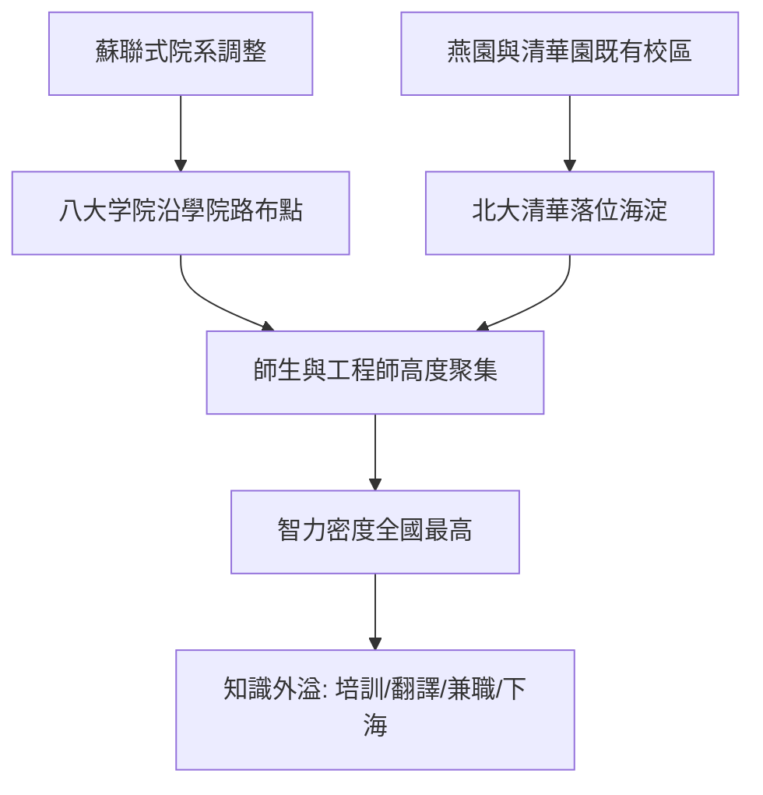

# 1.2 學院路與八大學院的智力布局

1950年代，北京在西北郊沿一條新建幹道南北展開「學院路」，陸續興建北京鋼鐵學院、北京航空學院、北京地質學院、北京礦業學院、北京林學院、北京農業機械化學院、北京石油學院、北京郵電學院等「八大学院」。這是仿照蘇聯模式、按產業部門設置專門學院的結果：每所學院對應一個重工業或戰略部門，教學、科研與國家計劃直接掛鉤。與此同時，北京大學自燕京大學校址遷入燕園，清華大學確立為工科旗艦，形成海淀「大學城」的骨架。

學院路的意義不僅在於建築群，而在於它製造了一種前所未有的人口結構：在幾平方公里內集中了數以萬計的教師、學生與工程師。若以簡單指標衡量智力密度，設面積 $S$ 內有研究人員 $N$、年科研經費 $F$，則智力密度可粗略表示為

$$\rho = \frac{N}{S}\cdot\left(1+\frac{F}{N}\right)$$

1950年代海淀的 $\rho$ 在全中國首屈一指，這正是後來一切技術產業在空間上「自發」聚集於此的統計基礎。

**因果分析**：八大學院的產生是國家戰略的因，其後果則超出計劃者的預期。計劃的目的是培養部門工程師，但其空間後果是知識外溢：師生在週末承接企業培訓、為工廠解決技術難題、翻譯外文資料，這些「體制外活動」在1980年代成為民營科技的胚胎。智力密度一旦超過某個閾值，就會自我強化——好學生想留下，好教師想聚集，政策也傾向於繼續在此投放資源。學院路因此成為中關村敘事中第一個真正的「生態節點」。

## 參考要點
- 學院路是計劃經濟的產物，卻孕育了市場化的種子。
- 智力密度是理解中關村的第一變數，其餘皆為其二階效應。
