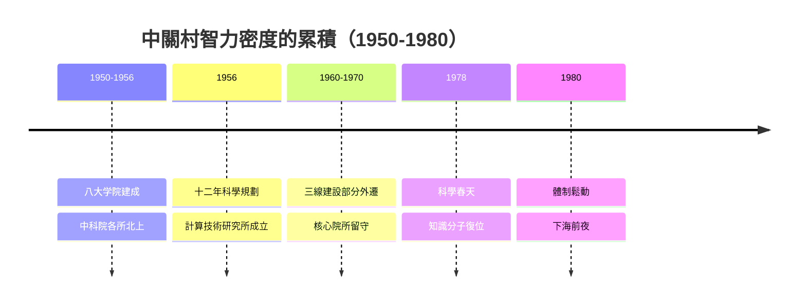

# 1.3 中科院北上與智力密度的累積

1950年代，中國科學院的各類研究所陸纊在北大、清華附近的中關村地區落地：數學所、力學所、物理所、計算技術研究所、自動化所等在此成片布局，形成了被稱為「科學城」的科研院區。1956年「十二年科學規劃」將計算機、半導體列為重點，中科院計算所等機構因此承擔了中國最早的電子計算機研製任務——此後「銀河」「曙光」等系列機型的技術血脈皆可追溯到這片院區。

至1970年代末，中關村一帶集聚了數十所高校與上百個科研機構，是全國兩院院士最密集的區域，智力密度堪稱亞洲之最。但這些知識資產被計劃體制鎖在院牆之內：科研與生產脫節，成果難以轉化，科研人員薪資微薄，「造飛彈的不如賣茶葉蛋的」之語流行於市。

## 因果分析

中科院的集聚使中關村具備了「技術存量」，而計劃體制的低效率則構成「轉化壓力」：一邊是閒置的智力資本，一邊是市場上對計算機與電子產品的饑渴需求。1978年的改革開放與「科學的春天」釋放了政治信號，兩者相乘，使得第一批科研人員跨出院牆的行為在1980年前後成為可能。前因是三十年的國家投資，後果是 即將到來的個體下海——智力密度不是自動變成產業的，它需要體制裂縫作為催化劑。

[下一節：2.1 陳春先下海與先行者的代價](02.1-陳春先下海與先行者的代價.md)
