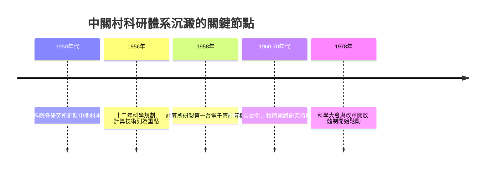

# 1.3 中科院與科研體系的沉澱

在八大学院與北大清華之間，中國科學院自1950年代起在中關村本部一帶建設了數學所、物理所、化學所、力學所、自動化所、計算技術研究所等一大批研究所，形成「科學城」。華羅庚、錢學森等歸國學者先後在此主持研究，計算技術研究所於1958年研製出中國第一台電子管計算機，1960年代又推進積體電路與大型機的研製。中關村由此同時擁有了基礎科學、工程技術與高等教育三種智力資源，這在全國絕無僅有。

計劃體制下的科研成果並不直接面向市場，而是服務於國防與國家工程。這造成一個關鍵的「蓄水庫」效應：數十年積累的技術、人才與設備沉澱在研究所圍牆之內，市場需求一旦出現，這座水庫便有了洩洪的可能。技術存量可近似看作隨時間累積的函數

$$K(t) = \int_{0}^{t} R(\tau)\,d\tau$$

其中 $R(\tau)$ 為年度科研投入產出的技術增量。1980年代以前 $K(t)$ 已相當可觀，只是缺乏轉化通道。

**因果分析**：中科院的沉澱與學院路的聚集互為因果。研究所需要大學輸送畢業生，大學需要研究所提供前沿課題與設備，這種循環使海淀的智力密度持續自我強化。更重要的是，1978年後的兩個制度變化——科學大會宣布「科學技術是生產力」、以及允許知識分子從事業餘兼職——為沉澱的 $K(t)$ 打開了閘門。沒有前三十年在圍牆內的積累，就不會有1980年代陳春先等人「下海」的技術資本；沒有1978年的鬆綁，這些資本將永遠沉澱。中關村的第一性資源，是制度鬆綁前夕恰好位於閘門之後的那座水庫。

## 參考要點
- 科研體系的「計劃性」與其後來的「市場性」是同一積累的兩個階段。
- 技術存量與轉化通道，缺一不可。
