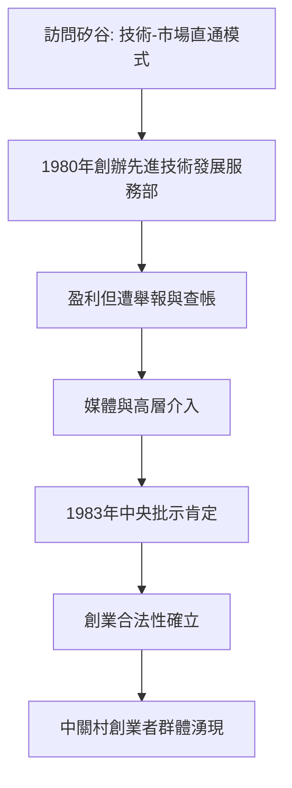

# 2.1 陳春先下海與先驅者的困境

1980年，中科院物理所研究員陳春先兩度訪問美國，親眼看到矽谷與波士頓128公路沿線：科研人員創辦公司，技術在實驗室與市場之間自由流動。對照中關村——技術同樣密集卻被體制封存——他提出「中國也要有自己的矽谷」。同年他率領數名研究員集體「下海」，在中關村的一間平房裡創辦北京等離子體先進技術發展服務部，承接技術服務、培訓與小型開發項目，成為中關村第一個真正意義上的民營科技實體。

陳春先的服務部很快盈利，但隨之而來的是體制的劇烈排異：他被指控「投機倒把」「損公肥私」，帳戶被查，人身安全一度受到威脅。1983年，在中央領導批示「陳春先的行為是對的，不是歪風」之後，爭議才告平息。這份批示的意義遠超個人平反——它首次在政治層面承認科研人員可以辦公司，為其後的創業潮掃清了合法性障礙。

**因果分析**：陳春先事件揭示了後發國家技術商業化的核心梗阻——不是缺技術，而是缺合法性。服務部的直接商業成就有限，其歷史功能是「試錯並定分止爭」：他用自己的官司為後來者換來了制度空間。因果鏈可以概括為：矽谷示範→個體下海→體制排異→高層背書→合法性外溢。沒有1983年的批示，1984年四通、聯想們的創立將面臨更大的政治風險。先驅者的價值，往往不在其企業的成功，而在其案例的法律與輿論遺產。

## 參考要點
- 陳春先被稱為「中關村第一人」，其服務部卻終未做大。
- 制度創新常常以個人受挫為代價先行試錯。
