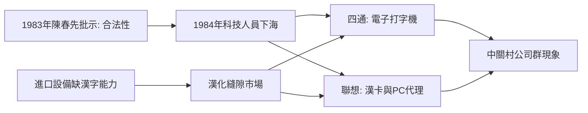

# 2.2 1984年創業潮：四通與聯想

1983年的合法性背書之後，1984年被稱為「中國公司元年」。這一年5月，中科院計算所、自動化所等單位的科技人員創辦四通公司，主營日本進口打字機的漢化改造，很快以MS-2400中外文電子打字機風靡全國辦公市場；10月，計算所所屬的20萬元創辦費催生了新技術發展公司，即後來的聯想，初期靠倒騰電子錶、旱冰鞋與批發PC維持生計，隨後押注倪光南的聯想式漢卡。同年，信通、科海、京海等公司相繼成立，中關村從零星試點變成群體現象。

這批創業者有三個共同稟賦：中科院或高校的技術背景、體制內的身份網絡、以及進口產品與本土需求之間的「漢化」縫隙市場。辦公自動化在當時的經濟核算下極為划算：一台電子打字機若把文書效率提升 $\eta$，則對擁有大量文書人員的單位，投資回收期

$$T = \frac{P_{\text{機}}}{\eta \cdot C_{\text{人工}}}$$

很容易小於一年，這解釋了為何漢卡與漢字打字機能在預算約束剛性的國營單位中暢銷。

**因果分析**：1984年創業潮是三股力量的交匯：制度面，陳春先案例與「松綁」政策使辦公司不再政治冒險；市場面，改革開放後單位辦公自動化需求爆發；技術面，中科院沉澱的漢字信息處理成果（如聯想式漢卡、四通的漢字終端）恰好填補進口設備的空白。四通與聯想的差異路徑同樣有因果意義：四通選擇「技工貿」中的貿與工優先，快速做大但技術根基建薄；聯想早期被迫以貿養技，卻因此活過了1990年代的市場洗牌。先驅者打開合法性，追隨者完成產業化——這是生態系成型的標準序列。

## 參考要點
- 「公司元年」的深層原因是合法性供給而非技術突破。
- 四通與聯想的興衰分岔為技工貿之爭提供了長期樣本。
