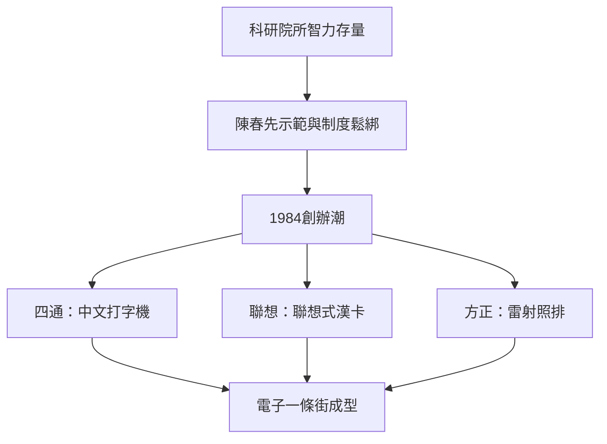

# 2.2 1984：四通與聯想的創立

1984年被後世稱為「中國公司元年」。這一年5月，中科院計算所、自動化所等單位的幾名科研人員集資兩萬元，創辦了四通新技術開發公司，主營MS系列中文打字機，迅速佔領機關與企業的文書自動化市場。同年11月，計算所所長曾茂朝等人支持王樹和、柳傳志等人以20萬元開辦費創辦「中國科學院計算技術研究所新技術發展公司」——即聯想的前身，初期靠倒賣電子錶、旱冰鞋甚至運動褲衩維持生計，隨後憑藉計算所倪光南的「聯想式漢卡」找到核心產品。

同一時期，北大創辦了新技術公司（方正前身），紫光、京海等也相繼成立。科研單位辦企業的模式「所辦」「校辦」成為中關村的主流形態：體制提供人員、場地與技術，市場提供收入。

## 因果分析

1984創辦潮的直接前因，是陳春先案例確立的合法性預期與城市改革（1984年十二屆三中全會）釋放的政策空間；而其隱含的驅動關係在於「院所—企業」的哺育結構：聯想的資本、人員與核心技術（漢卡）全部來自計算所，這種「母體輸血」使其跳過了初創死亡谷。後果同樣深遠：企業賺錢之後反哺院所，證明了科研體制與市場可以互動，為1988年試驗區的制度化提供了既成事實的支撐。

[下一節：2.3 1988試驗區與政策的鬆綁](02.3-1988試驗區與政策的鬆綁-1980-1992.md)
