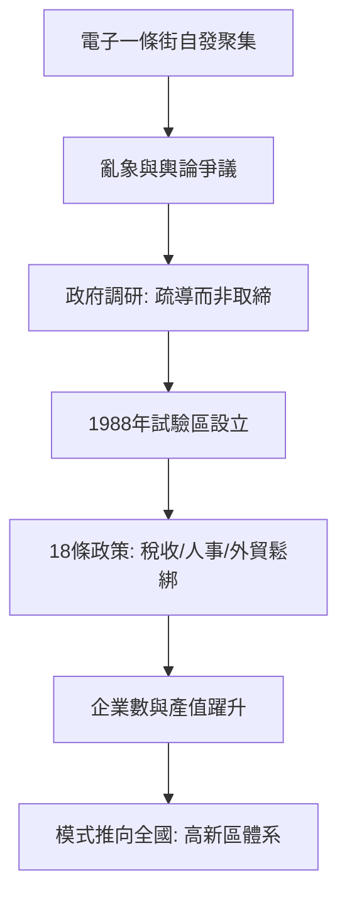

# 2.3 1988年新技術產業開發試驗區

到1980年代中期，「電子一條街」已沿白石橋路、海淀路自發延伸，數百家科技公司密集分布，泥瓦匠改行的「倒爺」與中科院研究員比鄰開店。自發繁榮也伴生亂象：倒買倒賣、假發票、走私零部件，輿論對「中關村是技術街還是詐騙街」爭論不休。北京市政府在反覆調研後，於1988年5月經國務院批准設立「北京市新技術產業開發試驗區」，這是全國第一個國家級高新技術開發區，以海淀為核心，劃定約100平方公里範圍，對區內新技術企業實行減免稅、放寬人事與外貿管制等18條優惠政策。

試驗區的本質是把自發市場納入制度化框架：企業認定「新技術企業」即可享受所得稅「三免三減」等待遇，設立所謂的免稅公式，令有效稅率大為降低。若名義稅率為 $t$、免減期為 $n$ 年，企業前期利潤為 $\pi_k$，則節稅現值可寫為

$$\Delta V = \sum_{k=1}^{n} \frac{t\,\pi_k}{(1+r)^k}$$

這筆省下的現金流對早期技術公司的存續至關重要。

**因果分析**：試驗區的設立體現了「承認既成事實、再加以規範」的中國改革邏輯。因果上是先有市場自發聚集，後有政策確認，而非相反；但政策確認又反向強化了聚集——免稅與人事政策降低了創業的制度成本，吸引更多科研人員離開體制，形成正反饋。1988年的另一深遠後果是範本化：中關村的試驗區模式在1991年被推廣為全國高新區體系，「一個地點的實驗」變成「一套國家政策」。從太監墳場到國家試驗區，中關村完成了從地理名詞到政策符號的第一躍遷。

## 參考要點
- 試驗區是對亂象的「制度化收編」，而非從零規劃。
- 稅收優惠的現金流價值對早期企業是生死線。
