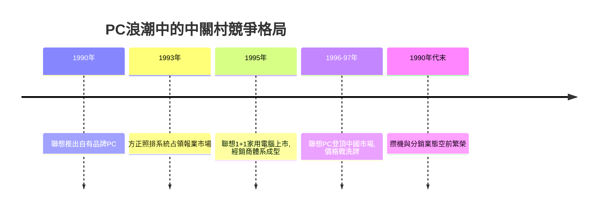

# 3.1 PC普及、漢卡與市場化競爭

1990年代初，個人電腦開始從機關走向企業與家庭，中關村的業態隨之升級：沿街小店從倒賣整機轉向組裝兼容機、分銷板卡與漢卡，長城、浪潮等國產品牌與IBM、AST、康柏等進口機同台競技。聯想於1990年推出自有品牌PC，並在1990年代中期憑藉「聯想1+1」家用電腦與經銷商體系迅速放量；同期方正依靠王選的漢字鐳射照排系統壟斷報業印刷市場，四通則逐漸在打字機市場的衰退中掉隊。中關村完成了從「集市」到「產業」的轉型。

PC時代競爭的核心是成本與渠道。國產廠商的優勢來自兩個不等式：一是本地化成本優勢，若進口機到岸總成本為 $C_i$、國產機成本為 $C_d$，則當 $C_d < C_i$ 時國產機即可擴張；二是規模經濟

$$\bar{c}(Q) = F/Q + v$$

即平均成本 $\bar{c}$ 隨產量 $Q$ 下降，聯想以分銷網絡做大 $Q$，把國際廠商的渠道劣勢轉化為自己的成本優勢，最終在1990年代末登頂中國PC市場。

**因果分析**：PC浪潮的因果鏈是：晶片性能沿摩爾定律下降、關稅與配額逐步放開、家庭收入提升，三者疊加令需求曲線右移；國產廠商以規模與渠道壓低 $\bar{c}(Q)$，在價格戰中擠出高成本的進口品牌。值得注意的是漢卡的角色變遷：在1980年代它是技術壁壘，到1990年代中後期隨Windows中文版普及而迅速貶值——聯想早已靠PC整機轉型，四通卻因過度依賴打字機而衰落。同一項技術，依附於何種主流平台，決定其命運。這一教訓深刻影響了中關村企業此後的戰略選擇：押平台，而非押單品。

## 參考要點
- 規模經濟與渠道能力是PC時代的決勝變數。
- 漢卡的興亡說明技術價值內嵌於平台生態。
